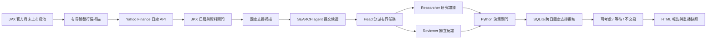

# Japan Support Desk：日股支撐觀察與決策

由 `codex/support-desk-phase1` 延伸的獨立日股版本。分支 `codex/japan-support-desk-phase1`，工作目錄 `personalmono/japan-support-desk`；原台股 checkout 保持原分支。先做尋找標的、反證與可追溯決策，未包含券商、帳戶或訂單流程。

標準決策流程固定三個模型 agent：**尋標（SEARCH）提出候選，研究（Researcher）形成及檢查交易假說，反證（Reviewer）獨立找漏洞並可否決**。三者共同產出單一「可考慮／等待／不交易」結論；Head和固定閘門是派工與驗證程式，不另算agent，不新增第四個決策agent。手動名單及離線demo是診斷入口，不冒稱完整三角色尋標流程。



## 執行

Python 3.11 以上，執行期不需要第三方套件。進入本工作目錄：

```powershell
python -m support_scout doctor
python -m support_scout japan-demo --out output/japan-demo
python -m support_scout observe --agents --scan-limit 100 --max-calls 7
python -m support_scout observe --no-agents --scan-limit 100
python -m support_scout observe --no-agents --symbols 6857,8035,4063
```

`Observe.cmd` 預設日本動態尋標，`OpenReport.cmd` 開最新完成報告。JPX 2026-09-30 母池實際納入 3,695 檔，每輪最多100檔，Core30→Large70→Mid400→其餘依序輪巡；完整一輪需37次執行，不宣稱每輪掃全市場。名單換版時接續上次標的，不每月重回前100檔。SEARCH 從本輪行情形成的最多40檔候選中選擇、重排或不選，再交獨立決策研究／反證 agent。模型不能憑記憶新增代號。

`--no-agents` 僅作數值預掃，清楚標示 NUMERIC_ONLY；不會宣稱已由 agent 找到。SEARCH 失敗或設定缺失時不派決策工作、不退回數值topN、也不前進agent模式的輪巡進度。只有成功提交／合法空選、帳本與報告完成後才推進；進度有程序鎖及版本CAS避免重複寫入跳批。

`--symbols` 是明確手動觀察模式，支援東京英數代碼。舊20檔名單保存在 `config/universe_jp.json`，只有指定 `--fixed-universe` 才使用。`--market TW` 保留原版台股相容入口，目前台股原分支仍為固定名單研究流程，沒有這次新增的日股SEARCH層。

每輪報告位於 `output/observations/<run_id>/report.html`。`latest.json` 指向已發布報告，`latest_attempt.json` 記錄最後嘗試；讀取時應同時查看狀態、資料日期與 `committed.json`。code 0 為觀察完成、2 為資料全部不可用／全域失敗、3 為部分資料或 agent 降級；0 不代表可以交易。

## 使用雙 Agent API

SEARCH、決策研究員和反證員使用不同上下文；決策研究／反證員收到同一份原始行情 packet，不看到 SEARCH 看多理由或對方答案。可分別指定研究與反證模型，這不是帶工具遞迴行動的 agent。模型無 shell 或券商工具。

整輪預設最多10次呼叫，**包含SEARCH**，剩餘額度只整對分派；例如上限7為1搜尋＋最多3對研究，上限10最多使用1＋8次，不為用滿額度湊數。每個角色無自動重試。直接 `desk` 入口也重驗SEARCH，不能藉其他CLI跳過。

```powershell
$env:OPENAI_API_KEY = '你的金鑰'
$env:SUPPORT_DESK_MODEL = '你可用的模型 ID'
python -m support_scout doctor --require-agents
python -m support_scout observe --agents --max-packets 5 --max-calls 10
```

本機已依使用者2026-10-28授權，在忽略的 `local_settings.json` 指向原 `STOCKLLM/.env`，沿用 `gpt-5.6-luna`，預設啟用agent；不複製整份 ENV，只載入 OpenAI key 與模型。新checkout依 `local_settings.example.json` 指定自己的來源。金鑰不進入快照、報告或Git。未設定模型時仍可跑數值預掃；要求agent卻缺設定時明確降級。真實模型呼叫會產生API費用，呼叫上限不是美元預算上限。

## 決策含義

| 結論 | 意義 |
|---|---|
| `CONSIDER` 可考慮交易 | 動態模式須本輪SEARCH有效提交，再通過支撐、資料／背景、雙方研究、淨情境風報與跨日檢查；交由人工評估 |
| `WAIT` 等待確認 | 型態尚未完成、資料或公司事件未知、審查未完成或跨日資料需核對 |
| `NO_TRADE` 目前不交易 | 支撐失效、反證否決、無可用型態、已追高或風險報酬不足 |

每檔保留研究資格 `RESEARCH/WATCH/REJECT`，並另外輸出交易研究結論，包含收盤參考、凍結支撐下緣、已知歷史阻力、情境成本後 RR、證據與下一步。參考收盤不是下一次可成交價格；支撐下緣是「日線收盤失效」條件，不是已設置或保證成交的停損。下個交易時段須重新驗證。

目前 Yahoo provider 固定 `observation_only=True`：未獨立核實公司行動、公司公告／決算、交易狀態與普通股分類，市場壓力亦未知。**目前真實 Yahoo 流程會輸出等待或不交易，不會直接升為 CONSIDER；即使兩個模型同意也一樣。** 完整的 CONSIDER 通道已以受控測試覆蓋，仍需下一階段補齊這些資料和策略驗證。這個狀態不能靠刪除 blocker 解決。

## 支撐模型與資料界線

保留既有因果模型：至少 60 根日線、前 20 日高點回撤 8%、左右各兩根較高低點後凍結 `低點 ± max(0.35 ATR14, 0.8% 低點)`；另日反彈 1.5 ATR，之後另日回測守住，後續收盤突破回測日高點。距支撐上緣超過 2.5 ATR 不追，收盤跌破凍結下緣即失效，不向下移動原支撐。規則尚未經樣本外驗證，不為了符合單一 Advantest 案例調參。

Yahoo OHLC 不與 adjusted close 混用；歷史調整語義仍未知。窗口內已知拆股會阻擋該檔。日圓成交值為 `close × volume` 估算，使用獨立日圓門檻。JST 15:30 收盤後保留至 16:00 發布緩衝，之前排除當日日 K；JPX 日曆已版本化至 2027 年，未知年份拒絕執行。漏日、過期、錯代碼、零量與來源失敗不以前值補齊。每次原始 JSON 保存 SHA256、取得時間與來源，今日下載的歷史資料不冒充歷史當時快照。

5% 當日帳戶虧損停工尚未實作，因為本階段沒有帳戶淨值、持倉與可信損益來源；不能用個股跌 5% 代替。Head 僅分派工作與執行固定檢查，沒有調高風險或下單的權限。

## 驗證與下一階段

```powershell
python -m unittest discover -s tests -v
python -m support_scout scan output/observations/RUN_ID/input.json --rules output/observations/RUN_ID/rules.json --out output/replay
```

重播還原當次資料與規則，不等於績效回測；重用當次 `reviews.json` 可驗證原 agent 裁決。每輪另存 `universe.json` 與 `search_audit.json`，保留母池原檔SHA256、名單日期、覆蓋範圍、搜尋packet／回應digest、數值預排與agent順序、理由、引用及三角色模型用量。未來資料不得改變既有截止的掃描。

下一步先補官方上市身分／公司行動／決算事件與市場背景，再做逐日走樣本外驗證及參數敏感度；確認券商後只替換行情 adapter，執行流程另外設計。暫不加入排程、Telegram、自動下單或帳戶風控。

[日股架構](docs/japan-architecture.md) · [JPX母池](docs/japan-universe.md) · [SEARCH與交接](docs/japan-discovery.md) · [Yahoo資料介面](docs/japan-provider.md) · [決策政策](docs/japan-decision.md) · [獨立審查](docs/japan-review.md)。其他未冠 japan 的文件保留自台股基底，以本 README 與日股文件為準。
