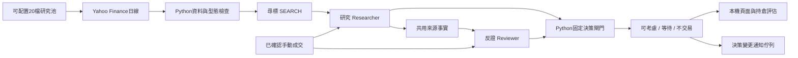

# Japan Support Desk：日股尋標與人工決策

目前版本0.10.0，工作分支 `codex/japan-support-desk-phase1`。預設從可配置的20檔日股研究池取Yahoo日線，再由**尋標、研究、反證**三個模型Agent共同完成決策。Head負責程式派工與驗證；沒有第四個決策Agent，也沒有券商下單能力。

2026-10-30新增短線機會：H-003趨勢回檔、H-004站回／突破（含待觸發）、H-005動能延續；保留H-002支撐試單。依使用者最新選擇，短線以3／5交易日、**股價+2%**為目標，不以PayPay費用提高選股門檻；成本後估算另外顯示。JX金屬5016及6027加入20檔池，暫換出8316及9432，兩者保留在備選欄位，整份名單仍可替換。高波動沒有方向時只列觀察，不冒充買訊。詳見[短線型態與評估](docs/short-cycle.md)。



三個角色使用不同上下文。反證員看相同原始證據與共用來源事實，不看尋標看多理由或研究員結論；共用事實不等於另做獨立檢索。同模型的錯誤仍可能相關。

## 開始使用

Python 3.11以上，不需第三方執行期套件。在本目錄執行：

```powershell
python -m support_scout doctor --require-agents
python -m support_scout observe --agents --max-packets 4 --max-calls 9
python -m support_scout serve
```

也可執行 `Observe.cmd` 產生報告、`Dashboard.cmd` 開啟本機服務，再瀏覽 <http://127.0.0.1:8765>。頁面提供最新決策、已確認持倉、成交回報，以及重新分析按鈕。服務只綁定本機；靜態 `report.html` 保存當輪結果，成交回報使用本機服務。

本機已依授權用忽略的 `local_settings.json` 指向原 `STOCKLLM/.env`，只沿用OpenAI key與模型 `gpt-5.6-luna`，不複製整份ENV或讀取券商欄位。新機器參考 `local_settings.example.json`。金鑰不進入報告、快照或Git。

## 可調整的研究池

`config/universe_jp.json` 保存版本、`max_symbols`及`symbols`；目前上限20檔。這20檔是Agent尋找機會的範圍，並非20檔都交給研究員，也不代表推薦或PayPay已確認可交易。日後提供PayPay名單可替換JSON，不必改Agent程式。

```powershell
# 使用另一份研究池；仍由SEARCH選股
python -m support_scout observe --agents --universe config/my_paypay_pool.json
# 只做數值掃描，明示NUMERIC_ONLY
python -m support_scout observe --no-agents
# 明確指定標的的手動診斷，不稱完整三角色尋標
python -m support_scout observe --agents --symbols 6857
# 保留的廣域JPX輪巡入口，非預設
python -m support_scout observe --agents --universe-source jpx --scan-limit 100
```

已確認持倉若在池外，可另外補取資料供持有／退出評估，不加入新進場尋標池。未來券商行情接點仍為 `observe(builder=...)`，母池也可由現有universe loader提供；資料身分、單位、調整口徑與時點必須重新驗證。

每輪總呼叫額度包含SEARCH，之後只整對派研究／反證；上限7為1次尋標加最多3對研究。不需選滿，失敗不回退數值topN。工具呼叫另有上限，不是金額預算。

## 積極人工評估與ADVANTEST

0.8.0新增H-002近期支撐守住／收復與 `config/opportunity.json` 的ACTIVE_MANUAL參數。三角色可共同輸出 `PROBE_BUY_REVIEW`（條件式人工試單）、WAIT或AVOID；原正式交易資格仍保留，不以舊ATR的失效價否決另一個獨立H-002。

參數不只交給Agent，也由Python重算：至少一個後續交易日守住、回測接近4%、原始縮量比0.85、收盤距錨最多6%；情境風險最多6%、成本與跳空後RR至少1.5，使用最近已確認的錨前pivot並列出更近供給區。兩方均同意且SEARCH有效才提出試單；反證、追高、行情修訂與來源不一致仍可阻擋。

真實10/26前綴的三角色實測已能選中ADVANTEST，兩方均支持條件式試單；10/27及10/29拒追高。這是根據已知案例新增參數後的探索，不能當成樣本外準確率。見[H-002](docs/active-pattern.md)及[積極決策與驗證](docs/active-decision.md)。

## H-001既有版本驗證

`config/patterns.json` 保留可版本化的機會假說：下跌後低點穩定、支撐測試／縮量、可核對的催化與公布後價格確認。H-001百分比支撐與原ATR交易資格分開，不混用失效價。

```powershell
# 真實行情，近兩週逐日截斷，含60根以上暖機
python -m support_scout advantest-case
# 數值門檻未入選時，明確做雙方診斷，最多6次模型呼叫
python -m support_scout advantest-case --agents --diagnostic-review --checkpoints d20261026,d20261028_after_ir,d20261029 --max-total-calls 6
python -m support_scout advantest-case-replay output/advantest-real-cases/RUN_ID
# 人造情境與負向對照，另行隔離
python -m support_scout pattern-case
```

**0.7.0僅H-001的真實案例沒有抓到使用者描述的買進機會。** 12個數值截點未形成正式尋標候選；3個重點截點的6次真實模型診斷均通過格式驗證，但兩方全部REJECT，最終NO_TRADE。主要差異為既有固定支撐錨、穩定區間過寬、量能參考口徑及反彈後距離；未為單例命中而調參。官方公司上修不等於超市場預期，沒有事前consensus就不聲稱超預期。

這是今日資料版本的歷史前綴重算，**不是歷史當時可得資訊回測**。保留真實取得時間、來源hash與各截點，禁止歷史即時搜尋，不寫正式帳本、持倉或寄信。見[真實案例紀錄](docs/advantest-real-validation.md)及[H-001定義](docs/japan-h001-pattern.md)。

## 精簡交流與用量

`config/communication.json` 定義JSON欄位、短證據別名、日線窗口、輸入bytes與回覆長度上限。完整證據留本地；傳輸仍保留支撐關鍵日、事件時點、缺口與已確認持倉，未知引用整份拒絕。

預設 `shared_once`：研究員搜尋一次，反證員取得同份來源事實與缺口，不帶研究員結論。保存行情的同快照比較，研究輸入bytes減少約80%，但**不是計費tokens減少80%**；實際tokens採API usage。2026-10-29固定20檔驗證共3次模型請求、49,493 tokens（含工具內容），其中反證員沒有再次搜尋。見[JSON協定與量測](docs/communication-protocol.md)。

## Python決策總表、成交回報與提醒

Python決策總表顯示哪檔、買入類型、買進／等待條件、目標與期限、建議金額／換算股數及情境虧損。個人本金及風險設定在忽略的 `local_data/sizing_settings.json`；初次每檔上限25%（可調）、多檔共享資金及新風險預算。只有條件式試單才給正數，等待／不進場為0，已有持倉不自動加碼。短線選股不計券商成本；部位風險與成本後報酬仍獨立估算，換算小數股數不代表實際成交。見[部位試算](docs/position-sizing.md)。

本機頁面填入代號、買賣、股數、實際價格、費用與日期，再勾「我確認已實際成交」才影響持倉。未勾選、研究建議與未回報交易均不視為成交。Python產生持倉JSON供下輪分析，保留成本與日期；可填固定失效價。持倉結論為HOLD、REDUCE_REVIEW、EXIT_REVIEW或REVIEW，缺原風險基準時不硬判續抱或賣出。見[持倉協定](docs/manual-portfolio.md)。

決策有意義變更時寫入通知佇列，同狀態不重複；Gmail寄收地址相同。本次使用者已重新授權寄送並指定ENV的GOOGLE_DEVEICE_PW，設定只引用該欄，不輸出或提交密碼。應用程式憑證的連線測試已獲SMTP接受；完整欄位已按使用者更正，僅從指定ENV讀GOOGLE_DEVEICE_PW；2026-10-30正式摘要信已獲SMTP接受，未輸出或提交憑證。見[ENV與郵件設定](docs/email-env.md)。

```powershell
python -m support_scout notify-status
```

使用 `notify-configure 你的地址 --env-file ENV完整路徑 --password-key GOOGLE_DEVEICE_PW` 明確引用GOOGLE_DEVEICE_PW；舊式本機憑證仍可用 `EmailSetup.cmd` 隱藏輸入Google應用程式密碼（不是登入密碼）。`notify-flush` 寄出待寄事件；SMTP結果不明會保留UNKNOWN，不自動重寄。詳見[操作手冊](docs/observation-runbook.md)。

## 決策與資料界線

| 結論 | 含義 |
|---|---|
| CONSIDER | SEARCH有效提交、資料／型態、雙方研究、情境風報及跨日檢查皆通過，供人工考慮 |
| WAIT | 型態、資訊或審查待補 |
| NO_TRADE | 失效、反證否決、無可用型態、位置過遠或風報不足 |

Yahoo目前固定 `observation_only=True`，公司行動、事件完整性、交易狀態及市場背景尚未獨立核實；原正式資格仍會停在WAIT或NO_TRADE；獨立積極人工機會通道可提出有待核對事項的條件式試單評估。模型同意不能解除這些缺口。參考收盤與日線失效價不是下個交易時段的保證成交價。

原因果ATR模型、JPX日曆、未完成日K排除、來源hash、固定支撐與跨日修訂保護保留。5%帳戶日損停工仍待可信淨值及損益來源，不能用個股跌5%代替。沒有自動下單或自動排程。

## 驗證與資料保存

```powershell
python -m unittest discover -s tests -q
```

報告在 `output/observations/RUN_ID`，查看 `latest_attempt.json`、`latest.json`與`committed.json`，先核對日期及狀態。exit 0表示流程完成，不表示可交易；2為全域失敗，3為部分資料／模型降級。2026-10-29固定20檔實測三角色成功；3檔公司行動待覆核，故整輪DEGRADED，沒有隱藏拒絕資料。

`local_data`包含原始資料、SQLite、成交與通知；`output`包含快照、AI評語、用量及重播報告。兩者與本機設定均不提交Git，需自行備份。

[架構](docs/japan-architecture.md) · [操作手冊](docs/observation-runbook.md) · [版本驗收](docs/japan-review.md) · [資料介面](docs/japan-provider.md) · [決策政策](docs/japan-decision.md)
