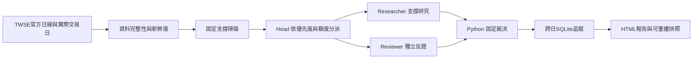

# Support Desk：台股支撐觀察

將 Advantest 的「先反彈、回測原支撐、後續確認且仍接近支撐」概念用於台股。已有官方日線擷取、獨立雙 Agent、跨日固定支撐追蹤與本地 HTML 報告，可用於收盤資料觀察。

分支：`codex/support-desk-phase1`。這是獨立專案，存放於既有 STOCKLLMVER2 遠端的獨立分支，與 develop 沒有共同歷史；請直接 clone 此分支，勿把它當作可直接 merge develop 的變更。Python package 保留 `support_scout` 名稱。



## 現在怎麼用

Python 3.11 以上，無第三方執行期相依套件。在本資料夾：

```powershell
.\Doctor.cmd
.\Observe.cmd
.\OpenReport.cmd
```

本機已依使用者授權，在 git 忽略的 `local_settings.json` 指向 STOCKLLM 的 OpenAI 設定，僅讀取 API key 與模型。金鑰不複製到報告、不提交；不匯入券商模組。新 checkout 請將 `local_settings.example.json` 複製為 `local_settings.json`，指定自己的設定檔與模型。

預設觀察固定 19 檔上市普通股，每輪最多選 5 檔做雙 Agent 研究、最多 10 次模型呼叫。先處理完整且接近支撐的候選，已遠離支撐的觀察排後面。沒有合格標的不湊數。執行模型會產生 API 費用。

```powershell
python -m support_scout observe --no-agents
python -m support_scout observe --agents --symbols 2330,2454,2317 --max-packets 2 --max-calls 4
python -m unittest discover -s tests -v
```

報告存於 `output/observations/<run_id>/report.html`；`latest.json` 指向最新完成的報告，`latest_attempt.json` 記錄最後嘗試。失敗有自己的紀錄，不把舊報告冒充新結果。最新指標有程序鎖及時間比較，舊資料重跑不能覆蓋新報告。

## 觀察能力與界線

- 官方 TWSE 月日線取 8 個月；市場日曆來自 FMTQIK 實際交易日，並以年度假日及台北 16:00 截止獨立檢查應有最新交易日。
- 每份來源保存原始 JSON、取得時間與 SHA256。缺月、漏日、錯代號或過期尾端均明示，失敗股票不補前值。
- Researcher 與 Reviewer 用相同快照、不同上下文；反證員可否決，身分與時間由程式分配。
- SQLite 保存原先支撐下緣／上緣；一旦失效不能同型態復活。資料修訂另標記，同日去重，倒退資料不覆寫目前狀態。
- 報告先在 SQLite transaction 中完整發布，再提交帳本與完成標記；失敗回滾，最新指標只在完成後更新。若程序在發布與提交之間中止，沒有 `committed.json` 的目錄不應視為成功。
- HTML 顯示暫定支撐、最新收盤、距離、失效條件、來源、兩方評語與跨日變化。

**目前是 OBSERVATION ONLY。** 公開資料採原始價格，尚未核實完整公司行動、公司公告／未來事件及官方鎖價狀態。這些缺口固定阻擋 `RESEARCH`，即使兩個模型同意也不會解除。平價 K 只是鎖價疑慮的保守代理。沒有下單、帳戶、持倉執行或 5% 帳戶停工功能。

這次真實執行已覆蓋 19 檔、每檔 162 根日線至 2026-10-27，並完成 5 檔／10 次模型研究。當時沒有完整規則確認且仍接近支撐的技術候選，輸出空候選名單是正常結果，不是系統失敗。

## 支撐規則與重播

至少 60 根日線；低點較前 20 日高點回撤 8%，左右各兩日低點較高，才在右側資料可得時凍結支撐。支撐區為 `低點 ± max(0.35 × ATR14, 低點 × 0.8%)`。另日反彈 1.5 ATR，之後另日回測未破、後續收盤突破回測日高點，才標規則確認。距上緣超過 2.5 ATR 不列技術候選；收盤跌破固定下緣即失效。這些是待驗證假設，分數不是勝率。

每輪保存 `input.json`、`rules.json`、`manifest.json`、`report.json`、任務與評語。manifest 保留實際截止、規則、來源程式 hash 與輸入 digest。

```powershell
python -m support_scout scan output/observations/RUN_ID/input.json --rules output/observations/RUN_ID/rules.json --out output/replay
```

[10/28–10/29 操作方式與驗收](docs/observation-runbook.md) · [獨立審查](docs/model-review.md) · [架構](docs/architecture.md) · [資料合約](docs/data-contract.md) · [路線](docs/roadmap.md)
