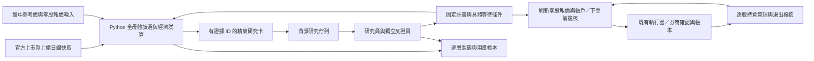

# TW Opportunity Flow — 全新台股研究系統

分支：`codex/new-system-tw-opportunity-flow`。2026-11-12 建立。

完整的流程圖、資料來源、取得時點、掃描間隔、模型決策及持倉管理，請參閱 [Opportunity Flow 流程參考](docs/OPPORTUNITY_FLOW.md)。最新介面與費率修正見 [1.2 檢討與驗證](reports/opportunity_flow_ui_fee_20261113/README.md)。

11/13 已完成 [六檔真正 CLI 研究、券商只讀及 SDK 介面驗證](reports/six_candidate_cli_20261113/README.md)：依使用者指示將最低保留金額改為 NT$5,000，重查後正式預算 READY，六檔帳戶門均通過；四次新 CLI 仍沒有雙方核准的 BUY。已修正實接會崩潰的匯入、下單前股數上下文及無限讀取等待，正式交易沿用原執行器。尚無正式 FLOW 實盤受理／成交／回寫證據，不能將只讀及回歸測試當作實盤驗收。

這是使用官方免費資料與既有 Codex CLI 的獨立研究流程。新入口是 **`OpportunityFlow.cmd` / `RunOpportunityFlow.ps1`**，程式位於 `opportunity_flow/`。原 STOCKLLM 說明保存在 [README_STOCKLLM_LEGACY.md](README_STOCKLLM_LEGACY.md)。1.1 版已接上現有正式帳本、群益券商執行器及最新 `codex/profit-exit-strategy` 分支的持倉與退出控制。

1.2 版主介面直接沿用舊 `Dashboard` 的資金卡、資金上限、持倉、行情時間、交割、正式委託與成交紀錄及策略模擬；新 FLOW 取代原小時掃描排程，另加全母體狀態、研究卡、兩方理由與模型／資料錯誤。原 `llm/agent` 切換不適用新流程，因此移除；「選擇 MD 策略」改為「流程／費用」。

**雙擊 `OpportunityFlow.cmd` 現在會啟動自動交易介面**，依既有帳戶設定在交易時間研究、複核及送出 BUY / SELL。研究通過後仍須更新零股買賣價、帳戶、持股及風控，最後交由原執行器送單；成交只按券商確認回寫。`Demo` / `Cycle` / `Watch` 保留獨立影子模式，不會自行載入券商；`RESEARCH_READY` 本身不是成交。

介面會列出券商總持股、人工與 AI 股數。選取股票，按「持股歸屬／轉交 AI」，沿用舊設定視窗填寫**調整後的 AI 總股數**；增加時填入新增股數的每股成本。例如原 AI 10 股、再交接 5 股，填 15；設為 0 即禁止 AI 買賣。若券商提供可核實成本，程式優先採用；目前原券商庫存解析沒有可靠成本欄位，因此通常需要輸入。交接是歸屬調整，不產生假買單；模型會看到「使用者轉交、原買進計畫未知」，按成本、完成日線、真實觀測與新風險決定續抱或賣出。未交接的人工股數不會被 AI 賣出。

## 改善的問題

兩週沒有成交需要檢查候選覆蓋、研究頻率、資料表達、數值條件、模型失敗及執行層；單靠提高模型呼叫次數不能區分這些原因。



- 上市、上櫃都納入，保留資料錯誤及缺漏的分母；完整母體不是固定 22 檔。
- 趨勢、回檔、回升、完成突破及盤中突破／收復分開辨識；盤中價格不冒充完成日線。
- Python 先計算支撐、目標、股數、費稅、滑價、報酬風險及未通過原因。LLM 不算術、不新增價位，也不能降低門檻。
- 證據卡提供數值摘要、價位來源、近八根 K 線、五日期限內的已成熟歷史變幅描述及資料缺口；完整來源留在本機。
- 研究員與反證員獨立讀相同凍結資料，不讀彼此的意見。WATCH 必須說明何種事實改變值得重審。
- 模型在背景審查，行情及數值監看繼續執行。每批至多三檔，後續批次持續輪替；沒有每日模型呼叫硬上限。
- 相同事實沿用凍結研究；價格變動達 0.3%、型態／資料／政策改變或研究超過四小時才重審。相同模型服務失敗退避五分鐘；錯誤不記為觀望。
- 已研究計畫的入場、失效、目標與股數固定，後續只重算目前價差下的經濟條件，不隨賣一價追價。

## 啟動

使用 Python 3.11 以上。純數值模式不需套件或模型；正式模式沿用原本 Windows 群益 SKCOM、帳戶環境及 Python 相依套件。`.trading-state.json` 或 `-StateRoot` 必須指向原本正式帳本根目錄；不會建立另一套虛構帳戶。

```powershell
# 只檢查本機設定與依賴，不登入券商、不送單：
.\RunOpportunityFlow.ps1 -Mode Check

# 啟動正式介面（與雙擊 OpportunityFlow.cmd 相同）：
.\RunOpportunityFlow.ps1 -Mode Live

# 可連券商讀取的演練模式；不送單、不撤單、不變更持股歸屬：
.\RunOpportunityFlow.ps1 -Mode Live -ReadOnly

# 純 CLI 正式模式，Ctrl+C 停止新委託：
.\RunOpportunityFlow.ps1 -Mode Live -Headless

# 離線合成案例，不連券商、不呼叫模型：
.\RunOpportunityFlow.ps1 -Mode Demo

# 初次建立官方完整母體、65 個交易日日線快取：
.\RunOpportunityFlow.ps1 -Mode Collect -Date '2026-11-11'

# 單輪數值研究，不呼叫模型；AsOf 使用台灣時間：
.\RunOpportunityFlow.ps1 -Mode Cycle `
  -Dataset .\local_data\opportunity_flow_market `
  -AsOf '2026-11-12T08:30:00+08:00'

# 前景試運轉；會使用現有 Codex 方案額度；Ctrl+C 結束：
.\RunOpportunityFlow.ps1 -Mode Watch `
  -Dataset .\local_data\opportunity_flow_market -Review

# 查看最新狀態、累計 tokens、失敗及等待條件：
python -m opportunity_flow status --state local_data/opportunity_flow_state
```

本次已下載的資料在 `local_data/official_market_20261111/`，可直接把上述 `-Dataset` 換成該路徑，避免重新建立同一份快取。Watch 會繼續更新這個目錄，目錄名稱不代表資料固定不再更新。

不消耗模型額度的持續監看，可直接使用：

```powershell
python -m opportunity_flow watch --dataset local_data/official_market_20261111 `
  --public-quotes --refresh-daily
```

模型只接受既有 ChatGPT 登入的原生 Codex CLI，沒有 API Key 或付費服務備援；額度不足明列錯誤。可用 `-Model` / `--model` 選擇自己帳號可用的模型，預設 `gpt-6-sol`。

## 間隔、資料與資源

| 工作 | 預設安排 | 模型使用 |
|---|---|---|
| 官方完整日線 | 啟動時補齊前一日；台灣 18:00 後更新當日，已有來源快取重用 | 0 次 |
| 盤中參考價 | 08:30～13:30，約每 30 秒最多 40 檔：優先 16 檔，其餘持續輪替；一次 HTTP 取一批，來源要求至少間隔五秒 | 0 次 |
| 數值重算 | 每分鐘，或輸入檔改變時；不是每分鐘重抓全市場日線 | 0 次 |
| 背景深研 | 每批三檔、兩個獨立角色；不阻塞行情主迴圈 | 每批兩次 CLI |
| 研究重用 | 相同事實沿用；新重要事實或四小時到期再審 | 未改變時 0 次 |
| 券商行情與帳戶 | 約每分鐘；既有 AI 持股加最多 20 檔研究股票，優先 12 檔、其餘輪替；單批最多 20 檔，上市市場 5、上櫃市場 6 | 0 次 |
| 公告／即將除權息 | 官方上市、上櫃各兩個端點，每 30 分鐘快取；來源錯誤明列 | 0 次 |
| 持倉管理 | 每分鐘檢查；各股模型指定下次重審 60～3,600 秒，跨價格帶、觸發退出／觀察價或股數變化提前重審 | 到期或重要變化時每股一次 CLI |
| 下單前複核 | 已形成 BUY / SELL 建議後再審；重新取得帳戶、報價與可賣股數 | 每次提案一次 CLI |

盤中公開行情是 **TWSE MIS 整股參考價**，只能觸發研究，不視為零股買賣價或成交證據。輪替池大小及成功／缺漏數會顯示，沒有把一批 40 檔說成全市場同時即時報價。HTTP 延遲會影響實際輪替週期。

影子模式可另以 `--quotes` 輸入已保存的最新零股 JSON；必須逐檔包含 `symbol`、`exchange`、`quote_status=LIVE`、`is_trial=false`、`quote_basis=capital_intraday_odd_lot`、帶時區的 `quote_timestamp`、`bid`、`ask`、`last_price`。正式模式直接向原券商執行緒取得零股行情；未知市場、試撮或過期資料不能送單。SELL 可使用有效買一價，缺少賣一價不會單獨阻擋退出。

正式模式沿用原 `support_agents.json` 的 `advisory` 研究契約：當前官方公告供模型審查，重大事件或來源不明阻擋新買進；原始未還原歷史仍明列限制，不冒充已核實的歷史公司行動。若既有政策改為嚴格查核，資料不足就阻擋新買進。影子層 `execution.missing` 保留嚴格探索資料缺口；正式送單另由 `execution_bridge` 依當前正式政策重新判定。

財務假設在 [policy.json](opportunity_flow/policy.json)：資金 NT$10,000、單檔配置至多 50%、模型風險至多資金 0.5%、淨報酬至少 2%、報酬風險至少 1.5、淨收益至少 NT$50、停損距離至少 0.6 ATR。普通股稅 0.3%、佣金 0.1425%、最低每邊 NT$1，另加每邊 10 bps 滑價情境。這是明列的研究假設，沒有讀取個人實收費率，也沒有為增加機會降低門檻。

正式模式會以原帳戶的資金上限、當前可用額及 `execution_live.json` 的最低佣金覆蓋影子假設。2026-11-13 依使用者指定的 [群益官方未折扣電子盤中零股標準](https://www.capital.com.tw/event/stock/oddLot/default.asp)，將綁定帳戶明確設為 **佣金率 0.1425%、每筆最低 NT$1**；原 **NT$20 保留為資金預留**，不再兼當最低佣金。沒有個別帳戶折扣或實收對帳單證據，未套用額外優惠。`planned_limits_enabled=false`、資金限制、配置、0.5% 模型風險、2%／NT$50 新買進門檻均保持不變。已持股沿用最新分支的費後獲利、原假設失效及重大風險退出判斷，買進可用額為零仍可賣出。

資料沒有額外付費方案；CLI 消耗既有 Codex 方案額度，額度不足會留下錯誤。總呼叫量取決於合格研究與持股數，沒有保證零成本的無限模型額度。舊版 8 次真實 CLI 用量只是先前研究試驗，不能當成新版每個交易日的成本。

## 狀態與檢討

| 狀態 | 含義 |
|---|---|
| DATA_BLOCKED | 日曆、來源、歷史或最新交易資料有缺口 |
| SCREENED_OUT / NO_SETUP | 未達流動性條件／沒有目前研究型態 |
| ECONOMIC_BLOCKED | 存在型態，價位、費後空間或風險條件不成立 |
| REVIEW_PENDING / REVIEW_IN_FLIGHT | 有數值合格路徑，等模型／模型正在判斷 |
| REVIEW_ERROR / REVIEW_SERVICE_BACKOFF | 模型或傳輸失敗，需要排查；不是市場判斷 |
| RESEARCH_WATCH / RESEARCH_REJECT | 尚待指定事實確認／假說有明確反證 |
| RESEARCH_READY | 兩方研究通過同一條既有合格路徑 |
| EXECUTION_DATA_NEEDED | 研究通過，執行證據尚缺；獨立於上方研究狀態 |

每輪保存 `summary.json`、`candidates.json`、`calls.json`；凍結 packets 以 SHA256 存在共用 `packets/`，每輪保存引用，避免重複存整份歷史。獨立 SQLite 帳本在指定 `--state` 下。`latest.json` 只由行情主迴圈發布，較慢的背景結果不會把較新的行情畫面覆蓋成舊時間。

正式模式的 `local_data/opportunity_flow_live/live_status.json` 顯示帳戶及交接，`latest_flow_execution.json` 顯示執行／阻擋原因，`handoffs/` 保存永久防重送紀錄。實際成交及未結單仍在原正式 execution ledger。送出後失去回應標記 `DISPATCH_UNKNOWN_DO_NOT_RETRY`，保留待對帳，不自動補送。資料更新在背景執行；更新失敗仍檢查既有持倉，並暫停依過期資料開新倉。

同一正式帳本只允許一個券商執行緒持有鎖；舊程式仍占用時，本版會顯示鎖定原因，需先正常關閉舊程式再開本版。按停止後不再送出新委託；已送券商委託須等確認或撤單，不能當作停止程式就已撤單。進行中的原模型呼叫最多等待既有 180 秒逾時；資料 HTTP 單次最多 45 秒，停止後不開始下一個請求。

首週檢討重點是母體覆蓋、資料成功率、數值合格率、模型完成率、具體等待條件、研究延遲及額度；不要把研究筆數當成成交數。原始未還原價格、當前公司名錄及回溯取得資料只適用探索；尚未證明這個系統有更高投資報酬。

## 驗證

```powershell
python -m unittest discover -s tests -p test_opportunity_flow.py -v
python -m unittest discover -s tests -p test_flow_execution_bridge.py -v
python -m unittest discover -s tests -p test_flow_dashboard.py -v
python -m unittest discover -s tests -v
python -m compileall -q opportunity_flow
```

原影子資料與真實 CLI 試驗見 [1.0 實作檢討](reports/opportunity_flow_20261112/README.md)；正式串接見 [1.1 整合紀錄](reports/opportunity_flow_live_20261112/README.md)；沿用舊 UI 與官方費率修正見 [1.2 驗證](reports/opportunity_flow_ui_fee_20261113/README.md)。自動測試使用隔離帳本與模擬券商，不會送實盤測試單；實際券商登入與成交仍須由開盤試運轉觀察。

參考做法：[Taiwan StockRadar 的日線／候選集保分層](https://github.com/Yen60229/Taiwan_StockRadar)、[stock-screener 的數值篩選與快照 CLI](https://github.com/xang1234/stock-screener)、[OpenAI 官方非互動 CLI 文件](https://learn.chatgpt.com/docs/non-interactive-mode)。本系統採自行實作，沒有整包複製第三方系統或安裝付費資料服務。
