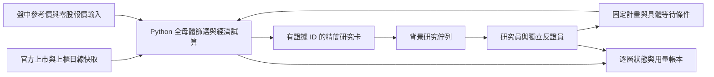

# TW Opportunity Flow — 全新台股研究系統

分支：`codex/new-system-tw-opportunity-flow`。2026-11-12 建立。

這是獨立的 Python 標準函式庫系統，使用官方免費資料與既有 Codex CLI。新入口是 **`OpportunityFlow.cmd` / `RunOpportunityFlow.ps1`**，程式位於 `opportunity_flow/`。原 STOCKLLM 說明保存在 [README_STOCKLLM_LEGACY.md](README_STOCKLLM_LEGACY.md)；舊模組留作比較，新入口不載入舊設定、帳戶、Agents SDK 或券商執行器。

本版先提供可持續運作的影子研究、模型佇列、價格條件監看及完整流失紀錄。`RESEARCH_READY` 是研究通過，`PAPER_REVIEW_READY` 也不是成交；程式沒有送單功能。

## 改善的問題

兩週沒有成交需要檢查候選覆蓋、研究頻率、資料表達、數值條件、模型失敗及執行層；單靠提高模型呼叫次數不能區分這些原因。



- 上市、上櫃都納入，保留資料錯誤及缺漏的分母；完整母體不是固定 22 檔。
- 趨勢、回檔、回升、完成突破及盤中突破／收復分開辨識；盤中價格不冒充完成日線。
- Python 先計算支撐、目標、股數、費稅、滑價、報酬風險及未通過原因。LLM 不算術、不新增價位，也不能降低門檻。
- 證據卡提供數值摘要、價位來源、近八根 K 線、五日期限內的已成熟歷史變幅描述及資料缺口；完整來源留在本機。
- 研究員與反證員獨立讀相同凍結資料，不讀彼此的意見。WATCH 必須說明何種事實改變值得重審。
- 模型在背景審查，行情及數值監看繼續執行。每批至多三檔，後續批次持續輪替；沒有每日模型呼叫硬上限。
- 相同事實沿用凍結研究；價格變動達 0.3%、型態／資料／政策改變或研究超過四小時才重審。相同模型服務失敗退避五分鐘；錯誤不記為觀望。
- 已研究計畫的入場、失效、目標與股數固定，後續只重算目前價差下的經濟條件，不隨賣一價追價。

## 啟動

只需 Python 3.11 以上。純數值模式不需安裝套件、帳號或模型。

```powershell
# 雙擊 OpportunityFlow.cmd，或執行合成控制案例：
.\RunOpportunityFlow.ps1

# 初次建立官方完整母體、65 個交易日日線快取：
.\RunOpportunityFlow.ps1 -Mode Collect -Date '2026-11-11'

# 單輪數值研究，不呼叫模型；AsOf 使用台灣時間：
.\RunOpportunityFlow.ps1 -Mode Cycle `
  -Dataset .\local_data\opportunity_flow_market `
  -AsOf '2026-11-12T08:30:00+08:00'

# 前景試運轉；會使用現有 Codex 方案額度；Ctrl+C 結束：
.\RunOpportunityFlow.ps1 -Mode Watch `
  -Dataset .\local_data\opportunity_flow_market -Review

# 查看最新狀態、累計 tokens、失敗及等待條件：
python -m opportunity_flow status --state local_data/opportunity_flow_state
```

本次已下載的資料在 `local_data/official_market_20261111/`，可直接把上述 `-Dataset` 換成該路徑，避免重新建立同一份快取。Watch 會繼續更新這個目錄，目錄名稱不代表資料固定不再更新。

不消耗模型額度的持續監看，可直接使用：

```powershell
python -m opportunity_flow watch --dataset local_data/official_market_20261111 `
  --public-quotes --refresh-daily
```

模型只接受既有 ChatGPT 登入的原生 Codex CLI，沒有 API Key 或付費服務備援；額度不足明列錯誤。可用 `-Model` / `--model` 選擇自己帳號可用的模型，預設 `gpt-6-sol`。

## 間隔、資料與資源

| 工作 | 預設安排 | 模型使用 |
|---|---|---|
| 官方完整日線 | 啟動時補齊前一日；台灣 18:00 後更新當日，已有來源快取重用 | 0 次 |
| 盤中參考價 | 08:30～13:30，約每 30 秒最多 40 檔：優先 16 檔，其餘持續輪替；一次 HTTP 取一批，來源要求至少間隔五秒 | 0 次 |
| 數值重算 | 每分鐘，或輸入檔改變時；不是每分鐘重抓全市場日線 | 0 次 |
| 背景深研 | 每批三檔、兩個獨立角色；不阻塞行情主迴圈 | 每批兩次 CLI |
| 研究重用 | 相同事實沿用；新重要事實或四小時到期再審 | 未改變時 0 次 |

盤中公開行情是 **TWSE MIS 整股參考價**，只能觸發研究，不視為零股買賣價或成交證據。輪替池大小及成功／缺漏數會顯示，沒有把一批 40 檔說成全市場同時即時報價。HTTP 延遲會影響實際輪替週期。

可另以 `--quotes` 輸入已保存的最新零股 JSON；必須逐檔包含 `symbol`、`exchange`、`quote_status=LIVE`、`is_trial=false`、`quote_basis=capital_intraday_odd_lot`、帶時區的 `quote_timestamp`、`bid`、`ask`、`last_price`。新系統不會自行登入券商。公司事件可用 `--events` 輸入逐股含來源與檢查時間的紀錄；事件查核與公司行動未知會阻擋執行資格，但不冒充歷史型態失效。

財務假設在 [policy.json](opportunity_flow/policy.json)：資金 NT$10,000、單檔配置至多 50%、模型風險至多資金 0.5%、淨報酬至少 2%、報酬風險至少 1.5、淨收益至少 NT$50、停損距離至少 0.6 ATR。普通股稅 0.3%、佣金 0.1425%、最低每邊 NT$1，另加每邊 10 bps 滑價情境。這是明列的研究假設，沒有讀取個人實收費率，也沒有為增加機會降低門檻。

## 狀態與檢討

| 狀態 | 含義 |
|---|---|
| DATA_BLOCKED | 日曆、來源、歷史或最新交易資料有缺口 |
| SCREENED_OUT / NO_SETUP | 未達流動性條件／沒有目前研究型態 |
| ECONOMIC_BLOCKED | 存在型態，價位、費後空間或風險條件不成立 |
| REVIEW_PENDING / REVIEW_IN_FLIGHT | 有數值合格路徑，等模型／模型正在判斷 |
| REVIEW_ERROR / REVIEW_SERVICE_BACKOFF | 模型或傳輸失敗，需要排查；不是市場判斷 |
| RESEARCH_WATCH / RESEARCH_REJECT | 尚待指定事實確認／假說有明確反證 |
| RESEARCH_READY | 兩方研究通過同一條既有合格路徑 |
| EXECUTION_DATA_NEEDED | 研究通過，執行證據尚缺；獨立於上方研究狀態 |

每輪保存 `summary.json`、`candidates.json`、`calls.json`；凍結 packets 以 SHA256 存在共用 `packets/`，每輪保存引用，避免重複存整份歷史。獨立 SQLite 帳本在指定 `--state` 下。`latest.json` 只由行情主迴圈發布，較慢的背景結果不會把較新的行情畫面覆蓋成舊時間。

首週檢討重點是母體覆蓋、資料成功率、數值合格率、模型完成率、具體等待條件、研究延遲及額度；不要把研究筆數當成成交數。原始未還原價格、當前公司名錄及回溯取得資料只適用探索；尚未證明這個系統有更高投資報酬。

## 驗證

```powershell
python -m unittest discover -s tests -p test_opportunity_flow.py -v
python -m compileall -q opportunity_flow
```

本次資料、流程及真實 CLI 試驗見 [實作檢討](reports/opportunity_flow_20261112/README.md)。

參考做法：[Taiwan StockRadar 的日線／候選集保分層](https://github.com/Yen60229/Taiwan_StockRadar)、[stock-screener 的數值篩選與快照 CLI](https://github.com/xang1234/stock-screener)、[OpenAI 官方非互動 CLI 文件](https://learn.chatgpt.com/docs/non-interactive-mode)。本系統採自行實作，沒有整包複製第三方系統或安裝付費資料服務。
