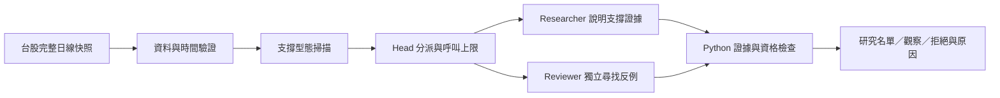

# Support Desk：台股支撐候選研究

先把「尋找支撐、核對證據、獨立反證」跑通。使用 Advantest 的型態概念研究台股，不接日本行情。這是研究架構，尚未產生真實市場候選或驗證投資績效。

獨立專案：`personalmono/support-desk`，分支 `codex/support-desk-phase1`。從開發中的 `support-scout` 取得研究骨架快照後獨立擴充；Python package 保留 `support_scout` 名稱，以相容原有工具與測試。



## 本次完成

- 固定支撐區 → 實質反彈 → 另日回測 → 後續收盤確認；最新價格仍須接近支撐。
- Head 依優先度分派研究，研究員與反證員使用相同快照、不同呼叫與上下文，互不讀取對方意見。
- 兩份有效意見都通過，且資料、公司與事件檢查無阻擋，才列 `RESEARCH`；缺資料或未確認列 `WATCH`，有明確反證列 `REJECT`。
- 固定規則有最終裁決權。模型不能改支撐線、門檻、身分或時間，不能用文字信心覆寫資料錯誤。
- 保存快照、規則、任務版本、兩份評語、執行身分、時間與逐次結果；雜湊綁定資料及任務指令。
- 可選 OpenAI Responses 執行器；預設是明示的離線流程示範，永遠不自動升為 `RESEARCH`。

**第一階段仍須由 JSON 匯入台股資料。** 真實行情擷取、公司行動／公告 adapter、績效回播、定時執行與持倉管理尚未接入。這次只驗證程式與模擬 API 回應，未呼叫付費模型或券商。

## 開始使用

Python 3.11 以上，無執行期第三方相依套件。從本專案資料夾執行：

```powershell
python -m support_scout desk-demo --out output/desk-demo --max-packets 2
python -m unittest discover -s tests -v
```

`desk-demo` 的行情、代號 9001–9006、日曆與代理評語都是合成測試資料；它示範分派和阻擋，不是選股結果。另有 `demo` 只做技術掃描、`scan` 匯入已有快照或人工審查。

準備符合[資料合約](docs/data-contract.md)的台股快照後：

```powershell
python -m support_scout scan local_data/taiwan_snapshot.json --out output/scan
python -m support_scout desk local_data/taiwan_snapshot.json --out output/offline
```

實際模型執行須在執行環境設定 `OPENAI_API_KEY`，並明確指定帳戶可用的模型 ID；程式不讀取其他專案的 `.env`。執行以下指令會送出快照並產生 API 費用：

```powershell
python -m support_scout desk local_data/taiwan_snapshot.json --provider openai --model YOUR_MODEL_ID --max-packets 5 --max-calls 10
```

`--reviewer-model` 可為審查員指定另一個模型；省略時用同一模型的獨立回合。不同回合不保證錯誤互相獨立。每個標的固定兩次呼叫，不重試；`--timeout` 預設 45 秒，是每次網路 I/O 的 timeout。`--max-output-tokens` 預設每次 2,000；沒有美元費用上限，呼叫數與 token 上限不等於固定費用。

`desk` 預設輸出至 `output/desk/<run_id>/`，每輪保留獨立紀錄。指定 `--out` 會更新該目錄中的同名檔案。輸出包含 `input.json`、`report.json`、`report.md`、`agent_tasks.json`、`reviews.json` 與 `desk_audit.json`。資料全數不合格回傳 code 2；代理失敗但報告已保存回傳 code 3；預算不足則記錄待處理名單。

## 「確認支撐」的初版定義

門檻是待驗證假設，不是獲利機率：

1. 至少 60 根完整日線。低點相較之前 20 日高點回撤至少 8%，左右各兩根日線低點都更高。
2. 右側第二根日線可取得時才識別低點，固定支撐區為 `低點 ± max(0.35 × ATR14, 低點 × 0.8%)`。ATR 是 14 根 true range 的簡單平均。
3. 另一天收盤站上支撐上緣加 1.5 ATR，才算實質反彈。
4. 反彈後另一日低點回到原區間、收盤在上緣以上，且距原低點至少三個交易日，才算回測未破。
5. 其後交易日收盤突破回測日高點，且當日與前日收盤皆在支撐上緣以上，才標 `RULE_CONFIRMED`。
6. 最新收盤距上緣超過建立時 2.5 ATR，退出技術候選；收盤跌破固定下緣即失效。pivot 左右窗口、反彈／回測／確認日有鎖價，不能列技術候選。

確認超過 10 個交易日、原低點超過 40 個交易日則過期。支撐不隨新低向下移；失效紀錄保留。這一版只涵蓋「回撤、反彈、再測」，等低雙底、突破回踩、上升趨勢高低點是未來的獨立型態。

下一步先接可靠的台股完整日線與公告資料，對照人工挑選的支撐正反例，再做逐日回播。見[架構](docs/architecture.md)、[審查紀錄](docs/model-review.md)、[階段路線](docs/roadmap.md)。
