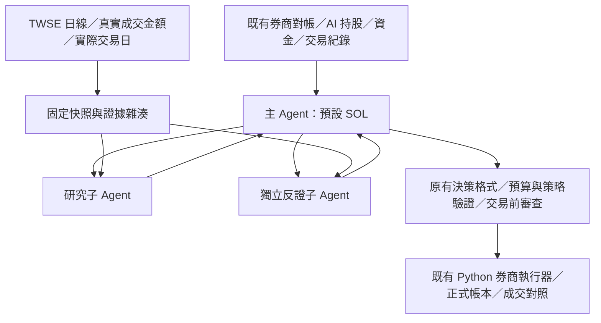

# STOCKLLMVER2 · Support Scout 整合版

分支：`codex/support-scout-architecture`。

此分支整合既有正式交易程式與 Support Scout 研究架構。正式交易底座取自 `fix/ai-sellable-ownership-display@46c020c`，已包含 `develop@363fe8f`、Agent 模式、券商對帳、AI／人工持股歸屬、資金及交易日修正。

## 啟動

使用 Windows、Python 3.11 以上，以下指令都在本原始碼資料夾執行：

```powershell
python -m pip install -r requirements.txt -r requirements-agent.txt
python -m support_scout doctor
.\RunSupport.ps1
```

雙擊 `Dashboard.cmd` 也會啟動同一入口，預設選擇 Agent 模式與本分支策略。按「分析並送交實盤風控」可能實際送單；啟動視窗本身不會啟用自動分析。

唯讀跑一輪（會連券商及模型，禁止送單）：

```powershell
.\RunSupport.ps1 -ReadOnly
# 同等命令
python -m support_scout live --read-only
```

命令列正式跑一輪：`python -m support_scout live`，會沿用正式帳戶設定及下單能力。

`doctor` 只核對本地帳本、憑證設定與 SDK，不會連券商或模型；`ready=true` 不代表券商登入或下單已驗證。

## 帳本與憑證

`.env`、兩個 SQLite 帳本及 `config/execution_live.json` 都從 `config.ROOT` 指向的正式資料目錄讀取。`.env`、資料庫及執行紀錄不進 Git。切分支時保留同一份正式帳本，不複製持倉或另建 Agent 帳戶。

從其他程式資料夾／worktree 接同一帳戶：

```powershell
.\RunSupport.ps1 -StateRoot '正式資料目錄的絕對路徑'
# 或先綁定，之後每次啟動沿用
python -m operations.bind_state_root --help
```

共用資料時只啟動一個 Dashboard／券商執行程序，既有跨程序鎖會防止同一帳戶重複執行。支撐子代理的政策從目前程式分支的 `config/support_agents.json` 讀取，研究產出仍寫入正式資料目錄。

## 主 Agent 與子 Agent



實際使用 OpenAI Agents SDK 的 `Agent.as_tool`。主 Agent 自選候選並呼叫 `research_support(symbol)` 與 `review_support(symbol)`，接收兩份結論後保有最終決策權。兩個子 Agent 讀相同不可變快照，不共享彼此的意見，不能下單或修改帳戶。兩次呼叫使用相同模型，流程隔離不代表統計上獨立。

模型預設 `gpt-6-sol`，可用 `OPENAI_AGENT_MODEL` 覆寫。每輪預設最多 2 檔、4 次子代理呼叫、每次 60 秒及 1,800 輸出 tokens；另沿用主 Agent 的回合及總時間上限。

`config/support_agents.json` 政策：

- `advisory`（預設）：每個 BUY 都需要兩方有效意見；任一方 REJECT 阻擋該檔新買進。WATCH 可供既有策略綜合判斷，並不表示支撐已確認。SELL 仍按原有退出風控執行。
- `confirmed_support`：另要求完整可核實的支撐資料、固定型態成立及兩方 RESEARCH。目前即時 adapter 尚未核實公司行動、公司事件與交易限制，這個嚴格政策會阻擋新 BUY。

券商資金、AI 可賣量、零股交易日限制、行情時效、交易成本、重複單及送單前再查資金，均由既有 Python 驗證。子研究結束後主 Agent 應重新查行情；帳戶或資金變動會使舊研究失效。

## 資料及紀錄

支撐研究預設取 100 根 TWSE 完整日線，保留真正「成交金額」，並以 FMTQIK 市場實際交易日檢查缺漏，臨時休市不算個股漏資料。16:00 台北時間後才可納入當日完整日線；尾端缺漏、個股漏交易日或來源失敗會明列不可用。

即時研究是 `RAW_PRICE_OBSERVATION`，未聲稱經除權息調整或已完成公司事件查核；上櫃與其他尚未支援的來源不冒充 TWSE 上市普通股。原有嚴格研究合約、固定支撐狀態機與離線掃描仍保留。

每輪在 `data/analysis/runs/<run_id>/` 保存 `agent_response.json`、`agent_tools.json`、`agent_sdk_tools.json`、`support_research.json`，以及原有建議、對帳、執行報告。Dashboard 分析區顯示子代理結論與錯誤。切分支導致 JSON 畫面快取遺失時，會直接從正式資料庫還原歷史分析及策略理由，明列為歷史資料；不會還原成可重送的建議或當成最新券商對帳。

## 驗證

```powershell
python -m unittest discover -s tests -v
python -m unittest test_advice_interface -v
python -m pip check
python -m support_scout demo --out output/demo
# 真實模型、合成資料，完全不連券商及送單；會使用 API 額度
python -m operations.verify_support_agent_sdk
```

2026-10-27 已通過 295 項回歸測試、3 項建議格式測試、真實 SOL 主／雙子代理呼叫、1101 的 100 根真實日線核對與 Dashboard 啟動／顯示檢查。22:24:48（UTC+9）的券商唯讀複查為 **OK／持股核對通過／預算 READY**，可買預算 NT$5,433.50；較早一次的 157 已未重現。實際測試未送單，正式買賣流程以模擬券商驗證。詳見 [整合與驗證紀錄](reports/support_scout_integration_20261027.md)。

## 研究文件

- [原始離線研究說明](docs/research-original-readme.md)
- [架構與權限](docs/architecture.md)
- [嚴格研究資料合約](docs/data-contract.md)
- [原有 Agent 交易底座](README_AGENT_MODE.md)
- [固定支撐規則與研究限制](docs/conversation-analysis.md)

研究排序及模型結論沒有校準成勝率，也尚未證明策略績效。
