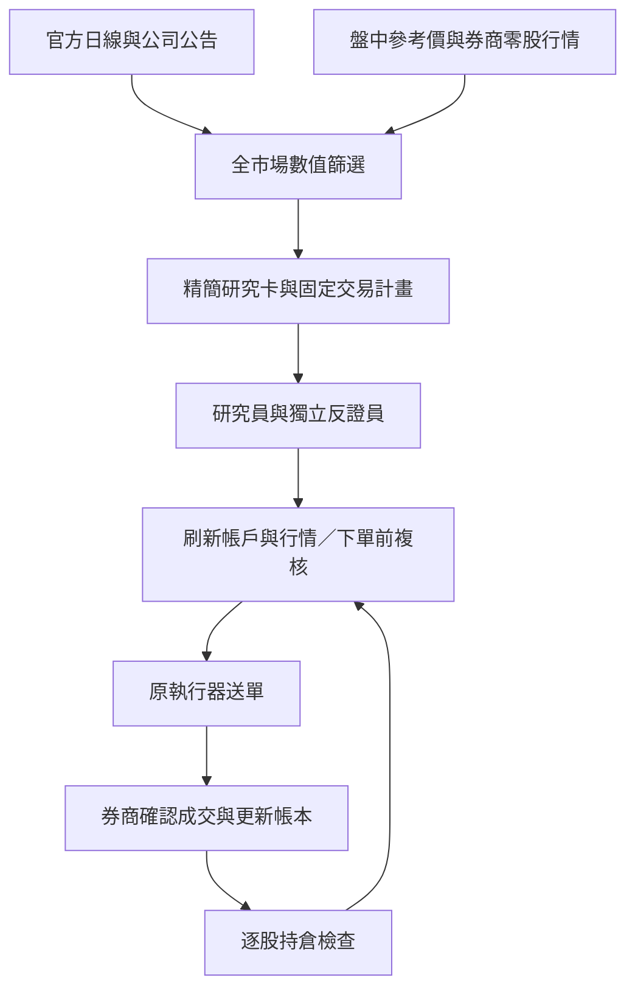

# Opportunity Flow 1.2 流程參考

更新日期：2026-11-13。適用分支：`codex/new-system-tw-opportunity-flow`。1.2 沿用完整舊 Dashboard，並依官方標準修正最低佣金；[最新變更與驗證](../reports/opportunity_flow_ui_fee_20261113/README.md)。原 1.1 執行器串接基線為 `be8db41`。

本版使用官方免費資料與既有 Codex CLI 研究台股，並接上原 STOCKLLM 執行器的買進、賣出、成交核對與持倉管理。以下時間皆為 **台灣時間（UTC+8）**；日本時間加一小時。程式須保持開啟，電腦不能休眠。

## 整體流程



研究通過後仍須通過當前帳戶、行情與下單前複核，才可能送單；送單受理也不等於成交。沒有新買進候選時，既有 AI 持股仍會進行退出檢查。

## 資料如何取得、多久更新

| 工作 | 資料來源與取得方式 | 時間與間隔 |
|---|---|---|
| 股票母體、完成日線 | 官方上市／上櫃公司名錄、交易日曆與全市場日行情；下載後保留來源、時間及 SHA256 | 啟動補缺漏；08:30 補齊前日，18:00 更新當日。保留約 65 個交易日並重用快取 |
| 公開盤中參考價 | TWSE MIS 的上市／上櫃普通交易參考價；供研究觸發，不作零股送單證據 | 08:30～13:30 約每 30 秒一批，最多 40 檔；優先 16 檔，其餘輪替 |
| 券商零股行情 | 沿用群益 SKCOM 執行緒，取得零股買賣價與成交時間；上市市場 5、上櫃市場 6 | 約每分鐘更新 AI 持股，加最多 20 檔研究股票；12 檔優先，其餘輪替，單批至多 20 檔 |
| 公司公告與即將除權息 | 官方上市／上櫃各兩個端點，共四個端點 | 每 30 分鐘更新快取；來源失敗與重大事件明列 |
| 帳戶、持股與未結單 | 原券商查詢、正式 execution ledger 與人工／AI 歸屬核對 | 約每分鐘核對資金、股數及未結單；送單前再次刷新 |

本機本次建立的普通股母體為 1,990 檔；這是該次名錄的數量，日後會隨官方名錄變動。首次沒有快取時，須先下載完整資料。盤中分批輪替，不代表全市場每檔都同時具備即時零股報價。上述間隔是排程目標，HTTP、券商查詢與模型延遲會影響實際時間。

日線更新在背景進行；更新失敗時，既有持倉可使用最後一份完整資料繼續檢查，依賴過期日線的新開倉會被阻擋。資料缺漏、來源錯誤與模型錯誤各自紀錄，不記成市場沒有機會。

## 掃描與決策的五個步驟

### 1. 掃描完整母體

約每分鐘重算完整母體；輸入更新時可提前重算。使用最近最多 60 個完成交易日，至少需要 21 個交易日。先核對交易日曆、最新資料、來源與缺漏，再檢查流動性與型態。

目前流動性門檻為近 20 日平均成交金額至少 NT$1 億、平均成交股數至少 10 萬股。未達條件、資料問題與沒有型態分開留下原因，不把全部股票直接送給 LLM。

### 2. Python 建立可計算的計畫

辨識趨勢、回檔、回升與突破，從已觀測的價位建立入場、失效與目標。Python 計算股數、費稅、滑價、報酬風險及既有持倉風險，形成可供模型選擇的固定路徑。

新買進目前要求單檔配置至多資金 50%、模型損失風險至多資金 0.5%、費後淨收益至少 NT$50、淨報酬至少 2%、報酬風險至少 1.5。正式模式按原帳戶的資金上限、當前可用額與佣金設定計算；模型不能自行降低門檻或新增價格。

### 3. 兩個獨立角色研究

合格候選每批最多三檔，分別交給研究員與獨立反證員，兩個角色不讀彼此意見。每批使用兩次既有 Codex CLI 呼叫。

模型閱讀精簡數值、近期 K 線、價位來源、固定路徑、公司事件及資料限制，輸出研究通過、觀察或否決。兩方必須同意同一條合格計畫，才會成為 `RESEARCH_READY`；觀察必須提出值得重審的具體條件。

研究在背景持續輪替，不綁定舊系統每小時一次的完整掃描排程。相同事實沿用快取；重要資料或型態改變、跨越關鍵價位、價格帶變動約 0.3%，或超過四小時才重審。模型服務失敗退避五分鐘，並留下錯誤。

### 4. 下單前複核，再交原執行器

形成 BUY 建議後，重新取得零股行情、帳戶可用額、持股與未結單，核對固定計畫仍成立，再進行一次獨立下單前複核。研究完成時若執行 worker 忙碌，結果會保留排隊；送出前仍須重新驗證時效與條件。

程式只在交易日 09:00～13:30 的允許時段送單，且須有當天有效、非試撮、未過期的正式零股報價。公開普通交易參考價不能代替零股證據。入場、失效、目標與股數保持固定，不能為追價而改寫。

最後交由原執行器處理資金、可賣量、人工股數、未結單及券商委託。原帳戶目前關閉 `planned_limits_enabled`，本版沒有自動開啟預掛。送出後失去回應會保留待對帳，不自動補送；同一決策有新交接帳本與原 executor decision_id 雙層防重送。

### 5. 成交後逐股持續管理

券商確認成交後才更新正式 AI 帳本；部分成交只更新確認股數，受理與未結單仍待後續核對。

約每分鐘檢查持股；模型指定下次重審為 60～3,600 秒，價格、風險、觀察價位或持股變化可提前喚醒。各持股分別快取，避免一檔變動就重問全部持股。沒有新候選或買進預算為零時，賣出檢查仍會繼續。

退出沿用最新持倉管理與獲利退出邏輯，綜合成本、原買進計畫、完成日線、真實盤中觀測、當前買一價及新增風險，決定續抱、賣出，或在原設定允許時預掛停利／撤單。風險退出可容許虧損；持有期限到期不會單獨造成強制賣出。撤單後須等待券商確認及最後成交，再推論剩餘股數。

## 人工持股轉交 AI

介面沿用舊資金、交割、正式委託／成交、持倉與模擬分頁；新增「FLOW 全母體與研究卡」。按「立即更新研究」更新輸入並沿用有效研究快取；「啟動 FLOW／停止 FLOW」控制新的持續流程，不會啟動舊每小時掃描。「流程／費用」查看目前門檻與官方費率，原模式與 MD 策略切換不適用新 FLOW。

介面列出券商總股數、人工股數與 AI 股數。選取股票，按「持股歸屬／轉交 AI」，沿用舊視窗填入**調整後的 AI 總股數**，增加時另填新增股數的每股成本。例如原 AI 10 股、再轉交 5 股，AI 管理股數填 15。也可減少 AI 股數歸還人工，或設 0 禁止 AI 買賣。

若券商提供可核實成本，程式優先採用；目前原券商庫存解析沒有可靠成本欄位，因此通常需要輸入。交接不建立假的 BUY 或成交紀錄；模型會看到「使用者轉交、原買進計畫未知」，交接日期不冒充原買進日期。未交接的人工股數不納入 AI 賣出量。

## 資源、費用與機會數量

- 官方資料服務沒有新增付費方案；模型消耗既有 Codex CLI 方案額度，沒有付費 API 備援。
- 新候選每批最多三檔、兩次 CLI；需重審的持股每股一次 CLI；每次 BUY／SELL 提案另做一次下單前複核。實際用量依候選、持股及重要變化而定，沒有保證零成本的無限額度。
- 群益官方電子盤中零股為 0.1425%、每筆最低 NT$1。2026-11-13 使用者指定沒有已知折扣、先採官方標準，綁定帳戶已明確設定最低 NT$1；原 NT$20 僅作資金預留，未改風控門檻。個別帳戶實收尚未以對帳單核對。[官方費率來源](https://www.capital.com.tw/event/stock/oddLot/default.asp)

以 2026-11-12 08:30 截點、昨日日線、1,990 檔普通股及 NT$10,000 資金重算：

| 每邊最低佣金假設 | 數值合格待研究 | 經濟條件未過 |
|---|---:|---:|
| NT$1（已採用的官方最低佣金） | 6 | 59 |
| NT$20（修正前由資金預留誤代的假設） | 0 | 65 |

這是同一份收盤價凍結資料的數值情境；1.2 重測兩組都保留資金預留 NT$20。尚無即時券商行情、帳戶核對或模型批准，不代表實際交易機會或績效。修正佣金參數後，配置、損失風險與獲利門檻保持不變；若日後取得不同個別費率，應以實收證據另作校正。

## 啟動與驗證紀錄

雙擊 `OpportunityFlow.cmd` 啟動正式介面，或使用：

```powershell
# 靜態檢查，不登入券商、不送單
.\RunOpportunityFlow.ps1 -Mode Check

# 正式介面
.\RunOpportunityFlow.ps1 -Mode Live

# 純 CLI 正式模式
.\RunOpportunityFlow.ps1 -Mode Live -Headless

# 可讀取券商，但不送單、不撤單、不交接
.\RunOpportunityFlow.ps1 -Mode Live -ReadOnly
```

同一帳戶的舊程式須先正常關閉，避免券商執行器鎖衝突。停止後不再送出新委託；已送出的券商委託仍須核對或確認撤單。進行中的原模型呼叫最多等待既有 180 秒逾時，不能把關閉介面當成已撤掉券商委託。

`be8db41` 的全套回歸為 **674 項通過，其中新增 37 項串接與故障測試**；啟動器 Check、離線 Demo 與編譯檢查均通過。本次使用模擬券商與隔離帳本，沒有登入實際券商或送出實盤測試單；開盤登入、正式行情及真實成交仍須由試運轉觀察。

1.2 的全套回歸為 **691 項通過**，新增 17 項舊 UI 重用、持股歸屬及佣金修正測試，詳見 [最新驗證](../reports/opportunity_flow_ui_fee_20261113/README.md)。

- [整合驗證、故障對策與費用敏感度](../reports/opportunity_flow_live_20261112/README.md)
- [機器可讀驗證紀錄](../reports/opportunity_flow_live_20261112/acceptance.json)
- [完整回歸輸出](../reports/opportunity_flow_live_20261112/regression.txt)
- [專案啟動說明](../README.md)
