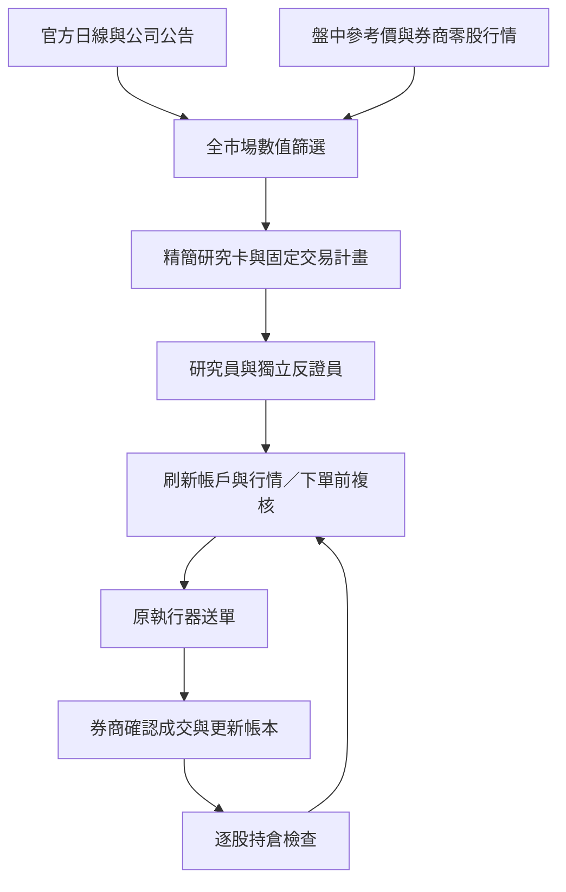

# Opportunity Flow 1.2 流程參考

更新日期：2026-11-19。適用分支：`codex/new-system-tw-opportunity-flow`。1.2 沿用完整舊 Dashboard，並依官方標準修正最低佣金；[介面與費用驗證](../reports/opportunity_flow_ui_fee_20261113/README.md)。11/16 已修正資金上限誤作最低餘額與 MIS 最近成交欄位處理，見[修復及啟動驗證](../reports/opportunity_flow_20261116_repair/README.txt)。11/18 新增 Windows 重開機與程序退出恢復，見[恢復驗證](../reports/opportunity_flow_recovery_20261118/README.txt)。11/19 修正 Reply 重設故障、守護遺失及事件資料輪替，見[故障恢復驗證](../reports/opportunity_flow_repair_20261119/README.txt)。原 1.1 執行器串接基線為 `be8db41`。

本版使用官方免費資料與既有 Codex CLI 研究台股，並接上原 STOCKLLM 執行器的買進、賣出、成交核對與持倉管理。以下時間皆為 **台灣時間（UTC+8）**；日本時間加一小時。程式須保持開啟，電腦不能休眠。

## 整體流程



研究通過後仍須通過當前帳戶、行情與下單前複核，才可能送單；送單受理也不等於成交。沒有新買進候選時，既有 AI 持股仍會進行退出檢查。

**正式模式為自動執行，不需逐筆人工確認。** 雙擊 `OpportunityFlow.cmd` → `Live` → 完整 Dashboard → 自動啟動 `FlowController`；背景研究結果經 `LiveCoordinator.offer()` 交給 `ExecutionBridge`，再由 `LegacyRuntime.execute()` → 原 `BrokerRuntime` → `execute_after_advice_written()` → `execute_advice_file()` → 原群益送單類別執行。正常流程不呼叫手動的 `real_order_test.py`。交易日台灣 09:00～13:30 允許委託；開盤前可先啟動放置。人工持股轉交 AI 是一次性的歸屬設定，不是每次買賣的批准程序。

## 資料如何取得、多久更新

| 工作 | 資料來源與取得方式 | 時間與間隔 |
|---|---|---|
| 股票母體、完成日線 | 官方上市／上櫃公司名錄、交易日曆與全市場日行情；下載後保留來源、時間及 SHA256 | 啟動補缺漏；08:30 補齊前日，18:00 更新當日。保留約 65 個交易日並重用快取 |
| 公開盤中參考價 | TWSE MIS 的上市／上櫃普通交易參考價；供研究觸發，不作零股送單證據 | 08:30～13:30 約每 30 秒一批，最多 40 檔；優先 16 檔，其餘輪替 |
| 券商零股行情 | 沿用群益 SKCOM 執行緒，取得零股買賣價與成交時間；上市市場 5、上櫃市場 6 | 約每分鐘更新 AI 持股，加最多 20 檔研究股票；12 檔優先，其餘輪替，單批至多 20 檔 |
| 公司公告與即將除權息 | 官方上市／上櫃各兩個端點，共四個端點 | 每 30 分鐘更新快取；來源失敗與重大事件明列 |
| 帳戶、持股與未結單 | 原券商查詢、正式 execution ledger 與人工／AI 歸屬核對 | 約每分鐘核對資金、股數及未結單；送單前再次刷新 |
| 介面資料同步 | 工作完成通知，另輕量檢查本機檔案與 SQLite WAL 版本；只有變動才讀取／重繪 | 事件通知後更新，每 5 秒檢查補漏；不查券商、不呼叫模型 |
| 手動健康檢查 | 沿用原券商對帳及可核實的本地修正，再以唯讀方式檢查帳本完整性、未確認委託、研究、設定及計時紀錄 | 按「健康檢查」執行；進行中顯示階段與秒數。非交易時段不要求盤中零股報價 |

本機本次建立的普通股母體為 1,990 檔；這是該次名錄的數量，日後會隨官方名錄變動。首次沒有快取時，須先下載完整資料。盤中分批輪替，不代表全市場每檔都同時具備即時零股報價。上述間隔是排程目標，HTTP、券商查詢與模型延遲會影響實際時間。

日線更新在背景進行；更新失敗時，既有持倉可使用最後一份完整資料繼續檢查，依賴過期日線的新開倉會被阻擋。資料缺漏、來源錯誤與模型錯誤各自紀錄，不記成市場沒有機會。

MIS 的頂層 `z` 是事件中的成交欄位，可能是 `-`；依官方前端的 `tradeFallback` 處理，該欄無有效價時使用 `trade.z` 和同筆的 `trade.t`。保留最近真實成交時間，不能改用查詢時間、14:30 feed 時戳、`pz`、昨收或買賣中價。沒有可核實成交仍記為缺資料；超過 120 秒的參考價不作新鮮觸發，公開整股參考價也不取得零股執行資格。查價結果附來源 SHA256 與回補筆數供追蹤。

## 健康檢查、券商優先與執行耗時

「健康檢查」會真正查詢券商並呼叫原 `sync_broker_state()`，不是只重載畫面。完整且新鮮的券商庫存及成交證據可以修正本地股數、歸屬與已確認成交；新增修正收據保存初始差異、修正內容與剩餘差異。本次曾修正過仍會顯示「需注意」，不以修正後 MATCH 隱藏原本的本地問題。未確認委託、無法核實的成本及不完整券商資料不會被猜成成交；保留已確認帳本並沿用交易阻擋。介面必要時可顯示最後核對股數，但標為舊資料，不恢復買進額度或券商驗證旗標。

BUY／SELL 使用相同原執行器並保留所有風控。新增計時只觀察既有呼叫，沒有為計時增加餘額或行情查詢。記錄整輪執行、研究完成與提案、下單前複核、券商執行緒排隊、帳戶／餘額／庫存／交割查詢、SDK 連線、送單、回報核對與帳本回寫；BUY 會記錄逐筆最新餘額檢查，SELL 保留原庫存路徑，不額外查餘額。

每事件具有含時區的台灣時間與單調時鐘毫秒偏移。新鮮度／資料時間保留原報價時戳；耗時使用 `perf_counter_ns`，避免系統校時造成負耗時。巢狀階段可能重疊，不能直接把各項總和當作整體耗時。「執行耗時」顯示最新一輪；有 BUY／SELL 提案時另存正式資料根目錄 `data/execution/timing/<trace_id>.jsonl`。執行報告與正式委託明細附 `execution_timing`／`timing_ref` 供追查。

滑價只在券商成交列能核實股票、買賣側、委託識別、價格及確認股數時，按成交均價對最後觀測買賣價計算；限價不是成交價。沒有完整成交證據時記為未知，不記 0。這是相對既有報價的觀測，不宣稱取得送單當下的新報價，也不保證實際成交或無滑價。

可離線整理歷史，不連券商或模型：

```powershell
python -m operations.review_execution_timing --date 2026-11-13 --output local_data/execution_timing_review.json
```

## 掃描與決策的五個步驟

### 1. 掃描完整母體

約每分鐘重算完整母體；輸入更新時可提前重算。使用最近最多 60 個完成交易日，至少需要 21 個交易日。先核對交易日曆、最新資料、來源與缺漏，再檢查流動性與型態。

目前流動性門檻為近 20 日平均成交金額至少 NT$1 億、平均成交股數至少 10 萬股。未達條件、資料問題與沒有型態分開留下原因，不把全部股票直接送給 LLM。

### 2. Python 建立可計算的計畫

辨識趨勢、回檔、回升與突破，從已觀測的價位建立入場、失效與目標。Python 計算股數、費稅、滑價、報酬風險及既有持倉風險，形成可供模型選擇的固定路徑。

新買進目前要求單檔配置至多資金 50%、模型損失風險至多資金 0.5%、費後淨收益至少 NT$50、淨報酬至少 2%、報酬風險至少 1.5。正式模式按原帳戶的資金上限、當前可用額與佣金設定計算；模型不能自行降低門檻或新增價格。

NT$10,000 是 AI 資金投入上限，沒有要求券商帳面餘額必須先達 NT$10,000。買進可用額取「券商可買金額扣最低保留及全部未結預留」、「AI 上限扣已投入及 AI 未結預留」、「當日剩餘額度」三者最小值。例如可買金額 NT$8,373、最低保留 NT$5,000、沒有其他占用時，可用額為 NT$3,373；其他資料驗證、配置、損失風險及送單前最新資金檢查照常執行。

最低保留額與 AI 資金上限是兩個獨立參數，沒有倍數、比例或互相改寫關係。券商可用資金較少時，只限縮本輪可用額；資金恢復後，重新按原 AI 上限計算，不必重設上限。「券商資金」區可直接設定最低保留額，沿用唯一的 `min_available_to_buy_twd`；修改後重新對帳，原 AI 上限、每日額度與費用設定保持原值。送單前會再次讀取最新最低保留，避免沿用研究開始時的舊值。FLOW 的 AI 上限設定也可高於當下券商餘額，實際下單仍只使用較小的核實可用額。單日買進上限繼續作為額外風控。

### 3. 兩個獨立角色研究

合格候選每批最多三檔，分別交給研究員與獨立反證員，兩個角色不讀彼此意見。每批使用兩次既有 Codex CLI 呼叫。

模型閱讀精簡數值、近期 K 線、價位來源、固定路徑、公司事件及資料限制，輸出研究通過、觀察或否決。兩方必須同意同一條合格計畫，才會成為 `RESEARCH_READY`；觀察必須提出值得重審的具體條件。

研究在背景持續輪替，不綁定舊系統每小時一次的完整掃描排程。相同事實沿用快取；重要資料或型態改變、跨越關鍵價位、價格帶變動約 0.3%，或超過四小時才重審。模型服務失敗退避五分鐘，並留下錯誤。

### 4. 下單前複核，再交原執行器

形成 BUY 建議後，重新取得零股行情、帳戶可用額、持股與未結單，核對固定計畫仍成立，再進行一次獨立下單前複核。研究完成時若執行 worker 忙碌，結果會保留排隊；送出前仍須重新驗證時效與條件。

程式只在交易日 09:00～13:30 的允許時段送單，且須有當天有效、非試撮、未過期的正式零股報價。公開普通交易參考價不能代替零股證據。入場、失效、目標與股數保持固定，不能為追價而改寫。

最後交由原執行器處理資金、可賣量、人工股數、未結單及券商委託。原帳戶目前關閉 `planned_limits_enabled`，本版沒有自動開啟預掛。送出後失去回應會保留待對帳，不自動補送；同一決策有新交接帳本與原 executor decision_id 雙層防重送。

### 5. 成交後逐股持續管理

券商確認成交後才更新正式 AI 帳本；部分成交只更新確認股數，受理與未結單仍待後續核對。

約每分鐘檢查持股；模型指定下次重審為 60～3,600 秒，價格、風險、觀察價位或持股變化可提前喚醒。各持股分別快取，避免一檔變動就重問全部持股。沒有新候選或買進預算為零時，賣出檢查仍會繼續。

退出沿用最新持倉管理與獲利退出邏輯，綜合成本、原買進計畫、完成日線、真實盤中觀測、當前買一價及新增風險，決定續抱、賣出，或在原設定允許時預掛停利／撤單。風險退出可容許虧損；持有期限到期不會單獨造成強制賣出。撤單後須等待券商確認及最後成交，再推論剩餘股數。

## 人工持股轉交 AI

介面沿用舊資金、交割、正式委託／成交、持倉與模擬分頁；新增「FLOW 全母體與研究卡」。按「立即更新研究」更新輸入並沿用有效研究快取；「啟動 FLOW／停止 FLOW」控制新的持續流程，不會啟動舊每小時掃描。「流程／費用」查看目前門檻與官方費率，原模式與 MD 策略切換不適用新 FLOW。

介面列出券商總股數、人工股數與 AI 股數。選取股票，按「持股歸屬／轉交 AI」，沿用舊視窗填入**調整後的 AI 總股數**，增加時另填新增股數的每股成本。例如原 AI 10 股、再轉交 5 股，AI 管理股數填 15。也可減少 AI 股數歸還人工，或設 0 禁止 AI 買賣。

若券商提供可核實成本，程式優先採用；目前原券商庫存解析沒有可靠成本欄位，因此通常需要輸入。交接不建立假的 BUY 或成交紀錄；模型會看到「使用者轉交、原買進計畫未知」，交接日期不冒充原買進日期。未交接的人工股數不納入 AI 賣出量。

## 資源、費用與機會數量

- 官方資料服務沒有新增付費方案；模型消耗既有 Codex CLI 方案額度，沒有付費 API 備援。
- 新候選每批最多三檔、兩次 CLI；需重審的持股每股一次 CLI；每次 BUY／SELL 提案另做一次下單前複核。實際用量依候選、持股及重要變化而定，沒有保證零成本的無限額度。
- 群益官方電子盤中零股為 0.1425%、每筆最低 NT$1。2026-11-13 使用者指定沒有已知折扣、先採官方標準，綁定帳戶已明確設定最低 NT$1；原 NT$20 僅作資金預留，未改風控門檻。個別帳戶實收尚未以對帳單核對。[官方費率來源](https://www.capital.com.tw/event/stock/oddLot/default.asp)

以 2026-11-12 08:30 截點、昨日日線、1,990 檔普通股及 NT$10,000 資金重算：

| 每邊最低佣金假設 | 數值合格待研究 | 經濟條件未過 |
|---|---:|---:|
| NT$1（已採用的官方最低佣金） | 6 | 59 |
| NT$20（修正前由資金預留誤代的假設） | 0 | 65 |

這是同一份收盤價凍結資料的數值情境；1.2 重測兩組都保留資金預留 NT$20。尚無即時券商行情、帳戶核對或模型批准，不代表實際交易機會或績效。修正佣金參數後，配置、損失風險與獲利門檻保持不變；若日後取得不同個別費率，應以實收證據另作校正。

## 啟動與驗證紀錄

雙擊 `OpportunityFlow.cmd` 啟動正式介面，或使用：

```powershell
# 靜態檢查，不登入券商、不送單
.\RunOpportunityFlow.ps1 -Mode Check

# 正式介面
.\RunOpportunityFlow.ps1 -Mode Live

# 純 CLI 正式模式
.\RunOpportunityFlow.ps1 -Mode Live -Headless

# 可讀取券商，但不送單、不撤單、不交接
.\RunOpportunityFlow.ps1 -Mode Live -ReadOnly
```

健康檢查的 FLOW 測試由原按鈕的「是／否」彈窗選擇，確認內容包含 0050 買進 1 股、限價 80 元、ROD，可能真實成交。選否只作一般檢查，顯示本次 FLOW 尚未測試。固定診斷假設明列模型呼叫 0 次，不能當成策略研究已找出交易機會。盤外採用明確標示的使用者固定價格請求，不偽造即時報價；透過同一原執行器及 COM owner 嘗試收單，保留帳戶／額度／未結／停用／防重送與計時。ROD 的預計交易日另存，避免盤外預約於下一交易日開盤前被本地錯誤到期。詳見 [診斷流程及驗證](../reports/health_order_test_20261113/README.md)。

診斷委託為使用者人工購買：原子保存歸屬、隔日仍只記錄券商狀態，不自動管理或本地到期，不加入 AI 股數、成本、研究日期、計畫或額度。AI 未結預留與人工預留分列；AI 配置／日額保持不受測試單占用，帳戶真實現金仍扣除所有已占用資金。

同一帳戶的舊程式須先正常關閉，避免券商執行器鎖衝突。停止後不再送出新委託；已送出的券商委託仍須核對或確認撤單。進行中的原模型呼叫最多等待既有 180 秒逾時，不能把關閉介面當成已撤掉券商委託。

`be8db41` 的全套回歸為 **674 項通過，其中新增 37 項串接與故障測試**；啟動器 Check、離線 Demo 與編譯檢查均通過。本次使用模擬券商與隔離帳本，沒有登入實際券商或送出實盤測試單；開盤登入、正式行情及真實成交仍須由試運轉觀察。

1.2 的全套回歸為 **691 項通過**，新增 17 項舊 UI 重用、持股歸屬及佣金修正測試，詳見 [最新驗證](../reports/opportunity_flow_ui_fee_20261113/README.md)。

11/13 後續已進行真正 CLI 六檔研究、真實券商帳戶／上市及上櫃零股讀取，並以真實 SKCOM 結構檢查 0050 一股買賣欄位。初查因最低保留 NT$10,000 而暫停買進，後依使用者明確指示改為 NT$5,000；12:44 重查預算 READY，六檔帳戶門全部通過，重跑四次 CLI 仍沒有雙方核准的 BUY。選股經濟、損失風險、配置及其他帳戶門檻保持不變。修正 `pending_exit` 匯入、固定股數的下單前上下文，以及原手動測試對拒單的誤報。研究結果、逐股原因、用量及證據邊界見 [六檔實查報告](../reports/six_candidate_cli_20261113/README.md)。

券商讀取新增外層期限：健康查詢 60 秒，行情 `45 秒 + 每 20 檔一批 × SDK timeout`（預設 12 秒／批），包含排隊與連線；逾時或晚回覆後停止新動作。可恢復的讀取會重查帳務；須更換執行程序時先等待原 owner 確實退出，不重送不明委託，不強制切換仍存活的 COM owner。關閉等待五秒後可回報仍在停止，原 owner 未結束前保留鎖。作業系統暫停時仍無法運作；這項防護不能當作真實委託已受理、成交或撤除的證據。

## Windows 更新與程序恢復（11/18）

11/24 補強：正式入口發現既有程序的執行內容不同時，會透過原 PID／run_id 請求正常退出，等待守護、介面與券商三個帳戶鎖全部釋放後再恢復。中途人工停止會取消自動恢復；仍在處理金融動作的 owner 不會被強制終止。相同程式僅新增報告提交時，保留既有程序。

新版心跳另保存程式、策略、提示詞及設定的內容指紋，排除日誌、文件與測試；與舊版交接時沿用 Git 程式差異核對。每分鐘重複啟動只檢查守護，不覆寫仍存活 owner 的驗收報告。心跳短暫讀取失敗時保留原時間，不偽造新心跳；持續過期仍請求正常恢復。Windows 檔案替換短暫衝突有有限重試，持續失敗仍保留最後完整檔案並記錄診斷。

下單前模型回覆與原驗證器的通過／否決／錯誤結果分別保存於研究帳本，保留脫敏理由。模型呼叫的 VALID 僅代表取得回覆，不能當作已批准交易。以上不修改現行行情、資金、計畫限價、持股歸屬或不明委託不重送規則。

交易電腦拉取更新後照常雙擊一次 `OpportunityFlow.cmd`，正式 Live 入口會安裝／修復原 `STOCKLLM Opportunity Flow` 排程，再啟動獨立背景守護程序。`-ReadOnly` 保持只讀，不安裝正式交易自動啟動。`-Headless` 初次手動啟動維持前景 Ctrl+C 停止，之後排程可在登入的使用者工作階段恢復相同模式。

- 完整排程：開機延遲 30 秒、本人登入延遲 15 秒、每分鐘存活觸發；允許補跑、忽略重複實例、取消預設執行時間上限，不因電池模式停止，不強制終止。開機觸發仍需要本人已登入的互動工作階段。無權建立開機排程時，改用目前使用者 Startup 捷徑；收據會明列實際只有登入觸發。若要完整開機／每分鐘排程，可由有權限的使用者以系統管理員身分執行同一正式入口一次。
- 守護程序每 5 秒檢查子程序。GUI 及 watch loop 心跳分開記錄；心跳逾 180 秒、watch 未在 180 秒內開始或迴圈逾 600 秒未前進時，請求原程序正常停止。仍存活的券商 owner 不會被強殺或另開第二個；逾 300 秒未退出記為 `STALLED_OWNER_WAITING`。
- 意外退出後重啟，10 分鐘內失敗 3 次則退避至窗口過期；失敗次數跨守護程序重啟保存。帳戶共用鎖同時阻擋其他 worktree／直接入口造成的重複 owner。
- 每次恢復使用既有正式帳本與新券商對帳，不把舊快照或舊 advice 當成授權。原資金保留額、AI 上限、日額、未結圈存、資料時效、研究／複核、損失／費後門檻、人工持股及防重送規則照常生效。通過條件後自動研究、複核、送單，成交確認後持續管理與賣出。
- 按「停止 FLOW」、使用者關閉視窗或前景 Ctrl+C 會持久保存暫停；排程不會覆蓋。Windows 正在關機時不當成使用者暫停。再次使用正式入口或按「啟動 FLOW」恢復。

收據、心跳及守護日誌位於原帳戶目錄 `data/health/flow_recovery/`：`task-registration.json` 列實際安裝方式與觸發、`supervisor_status.json` 列目前程序／對帳狀態、`supervisor.jsonl` 列啟動與恢復事件。完整測試及實測邊界見[11/18 驗證紀錄](../reports/opportunity_flow_recovery_20261118/README.txt)。

### 正式入口的實機檢查與自動匯出

11/19 恢復補強：連續三次券商健康回報 `CapitalReplySessionError: Reply reset failed: rc=9999` 時，停止舊研究交接、清掉待執行提案並請求目前程序正常退出。守護仍按既有退避啟動原 Live 入口，建立新 COM 會話，先重新對帳再恢復研究、複核及持股管理；庫存或對帳未核實時不解除阻擋。這不會清除帳本中的未結／不明委託，也不重送舊 advice。

守護與 FLOW 互相檢查：FLOW 在心跳時嘗試帳戶專屬 `flow-supervisor` OS 鎖（至少間隔 10 秒；忙碌時待心跳恢復），只有確認原守護不再持鎖才補起新守護，並要求自身正常退出。新守護等待 Dashboard／券商鎖都釋放才建立新程序；重新啟動入口也能對目前已知的孤立 FLOW 發送相同 PID／run_id 的正常交接要求，不干預不明或其他程式 owner。使用者停止與 Windows 關機時不補起守護。守護的狀態／日誌暫時寫入失敗不再直接終止監看，異常退出留下事件及本機錯誤輸出。

Windows 安裝依序嘗試完整開機＋登入＋每分鐘排程、本人登入＋每分鐘排程，最後才退回 Startup 捷徑；收據與檢查列出實際生效的觸發。Windows 回傳的帳號名稱會先轉成 SID 比對，避免把同一使用者誤認成設定不符。

公司事件改為與零股行情輪替分開的全母體索引；只載入該公司的公告及公司行動，保留完整的來源錯誤與時效檢查。正式帳戶事件來源變成未檢查／不可用時，狀態為 `REVIEW_DEFERRED_EVENT_SOURCE`，停止付費重審、不覆蓋先前有效研究；來源恢復且事實沒變時沿用凍結研究，有新公告等實質變化時照原規則重審。

交易電腦更新後，原 `OpportunityFlow.cmd` 正式入口依序安裝／修復恢復設定、啟動守護程序、讀回目前 Windows 排程／捷徑，再等待本次程序的新對帳與研究運行。CLI 模式亦在每日資料更新前先進行初次券商對帳。檢查使用原流程留下的心跳與事件，不增加另一個券商 COM owner，也不另派驗收委託。

啟動視窗最多等待 180 秒，背景檢查會繼續。每 60 秒讀回 Windows 設定，報告每 30 秒或狀態改變時更新；包括盤外、資料下載、對帳阻擋、版本不同、手動停止及存活異常。原帳戶目錄的 `data/health/flow_recovery/runtime-audit.json` 保留副本；程式目錄自動匯出 `reports/opportunity_flow_runtime/latest.json`／`latest.txt` 與各次執行的 `runs/*.json`。若 Git 目錄無法寫入，帳戶副本明列匯出錯誤。

「已確認」須同時符合實際啟動物件有效、目前子程序 PID／run_id 正確、執行版本一致、本次啟動後重新對帳及有效研究迴圈。`AUTOMATION_ACTIVE` 另須已觀測數值研究掃描；`WAITING_RESEARCH_WINDOW` 表示盤外正常等候。兩者都不代表已買進；送單、成交及持股管理事件分開列示，只有實際經過原流程才記錄。資料更新或新錯誤不會被較早的成功掃描遮蔽。

研究與成交紀錄只匯出白名單欄位，包括時間、階段、計數、股票代碼及原風控阻擋代碼；不匯出帳號、憑證、私人路徑、模型原文或原始 SDK 回覆。資金卡列最低保留額、獨立 AI 上限、最後對帳的新買可用額與日額，須連同對帳時間閱讀。檢查寫檔故障不會改變已完成送單的結果或觸發重送。啟動器不自動操作 Git 提交／推送；匯出檔可隨交易電腦原本的提交保存到遠端。報告格式見[實機匯出說明](../reports/opportunity_flow_runtime/README.txt)。

- [整合驗證、故障對策與費用敏感度](../reports/opportunity_flow_live_20261112/README.md)
- [機器可讀驗證紀錄](../reports/opportunity_flow_live_20261112/acceptance.json)
- [完整回歸輸出](../reports/opportunity_flow_live_20261112/regression.txt)
- [專案啟動說明](../README.md)
