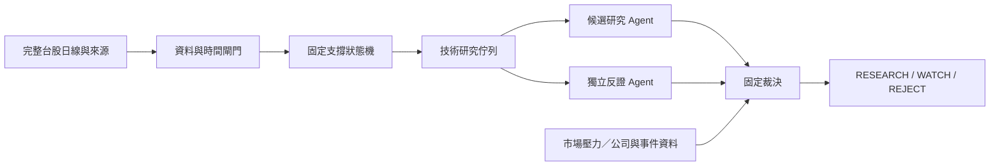

# Support Scout：台股支撐候選研究

> 此為正式交易整合前的原始設計存檔；目前啟動方式及已完成整合以根目錄 README 為準。

第一階段先把「尋找回測後支撐成立、目前還靠近支撐的標的」做成可檢查的研究流程。範圍暫限台灣上市／上櫃普通股，Advantest 僅作型態參考。

新專案：`personalmono/support-scout`。分支：`codex/support-scout-architecture`。



## 已完成

- 完整日線合約、資料截止、交易日完整性與公司行動口徑檢查。
- 固定低點區間 → 反彈 → 不同日回測 → 後續收盤站回的因果狀態機。
- 支撐失效、型態過期、價格已遠離支撐、低流動性及鎖漲跌停的閘門。
- 可解釋的技術研究排序、每一步的證據日期及實際可知時間。
- 分別給研究與反證 Agent 的任務包，及綁定快照雜湊的雙方審查匯入。
- 反證方可以否決；兩方同意也不能覆寫資料與型態閘門。
- 離線合成情境及不偷看未來的回歸測試。

**本版尚未接真實台股資料 adapter、自動 LLM 執行器或績效回測。** Agent 的 runtime 介面採匯出任務包／匯入審查，尚不會自行呼叫模型。這一輪開發已另外請子代理分析方法及獨立審查實作。執行不需要 API key、不會呼叫模型或券商。

## 執行

Python 3.11 以上即可；直接在本資料夾執行，不需安裝套件。

```powershell
python -m support_scout demo --out output/demo
python -m unittest discover -s tests -v
```

Demo 會產生 `report.md`、`report.json`、`agent_tasks.json`、`input.json`。所有價格、日曆、公司資料及 9001–9006 代號都是合成測試情境，不能當成真實選股結果。沒有雙方有效審查時，技術成立的標的仍為 `WATCH`。

正式資料按照 [資料合約](docs/data-contract.md) 準備：

```powershell
python -m support_scout scan local_data/taiwan_snapshot.json --out output/taiwan
python -m support_scout scan local_data/taiwan_snapshot.json --reviews local_data/reviews.json --out output/reviewed
```

`--as-of` 可縮小截止時間，但必須有當時已可取得、調整口徑正確的資料；不能只把今天下載的歷史資料改日期，就稱為歷史回測。

```powershell
python -m support_scout scan local_data/taiwan_snapshot.json --as-of 2026-10-27T16:00:00+08:00 --out output/replay
```

全批資料均不合格或全域合約錯誤時，CLI 回傳 exit code `2`；單支資料失敗保留原因，其他標的繼續研究。`technical_queue` 是形態篩選結果；`reviewed_shortlist` 才是資料、背景及雙方審查均通過的名單。`RESEARCH` 仍只是研究資格。

## 支撐怎麼判斷

以下門檻是可測試假設，尚未證明具有投資優勢：

1. 至少 60 根完整日線。低點較之前 20 日高點回撤至少 8%，且左右各兩根 K 的低點都高於它，才識別 pivot。
2. 在右側第二根 K 可得時建立固定區間：`pivot low ± max(0.35 × ATR14, 0.8% × pivot low)`；ATR14 是當時 14 根 true range 的簡單平均。
3. **另一天**收盤高於區間上緣加 1.5 ATR，才算反彈。
4. 反彈之後另一日低點進入原區間、收盤在上緣以上，且距原低點至少三個交易日，才算回測未破。
5. 後續交易日收盤高於回測日高點，且連續兩次收盤位於區間上緣以上，標為 `RULE_CONFIRMED`。
6. 收盤低於固定下緣即 `INVALIDATED`。低點區間不向下移；新 episode 至少在失效後十個交易日之後重新建立，舊失效紀錄保留。

最新價格高於支撐區超過 2.5 個建立時 ATR，列為 `EXTENDED`。已確認但最新又收回區間內，保留歷史型態狀態、退出技術候選。確認超過 10 個交易日或原低點超過 40 個交易日，型態過期。

## 分工與下一階段

- [架構及 Agent 邊界](docs/architecture.md)
- [貼文分析與統計限制](docs/conversation-analysis.md)
- [台股資料合約與現有專案銜接](docs/data-contract.md)
- [分階段路線](docs/roadmap.md)
- [獨立審查紀錄](docs/model-review.md)

先接好可驗證的台股日線與公司行動資料，再逐日回放；之後才比較「只看跌深反彈」與「等待回測站回」的假訊號率、報酬幅度及途中回撤。貼文 39 次事件的統計不會被當成個股的模型勝率。
