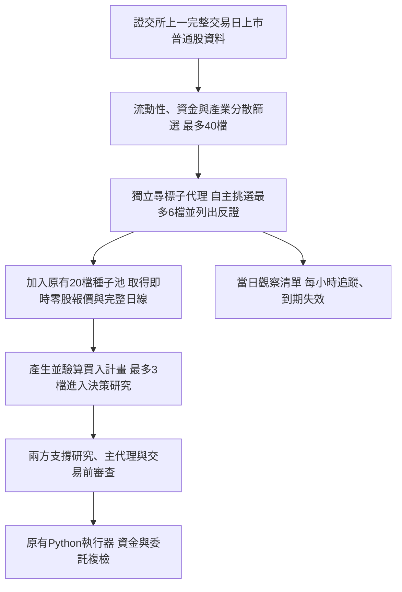

# 主動尋標、配置調整與錯誤檢討

後續已依指示取消研究用量額度，詳見 `research_without_quotas_20261105.md`。本報告保留先前部署與事故檢討當時的設定紀錄。

日期：2026-11-05。下列交易紀錄時間以台北 UTC+8 為準，日本時間另加一小時。

## 已實作的架構

- 正式策略：`strategy_opportunity_v2`，11 月 4 日已保存選擇並重新載入。
- Early／Confirmed／Strong 單檔累積配置：35%／45%／50%，以 10,000 元策略資金計為 3,500／4,500／5,000 元。
- 同檔原有曝光、可用現金、整輪預算與送單前複檢仍共同限制實際股數；同檔模型失效情境損失預算仍為 50 元。增加配置並不代表一定會買滿或能獲利。
- 60 分鐘掃描保留，日本時間 14:05 的既有時段保留。

尋標不是由主代理看到可買計畫後才選擇是否執行；現在會在計畫篩選之前獨立派出。它沒有下單權限。來源為上一完整交易日整股資料，不是假定整個市場都有即時零股行情，也尚不涵蓋上櫃市場。

每日最多兩次尋標、成功或失敗均占一次額度，間隔至少三小時；同日未到重評時間沿用有效清單。原本單輪一檔都未通過的情況，仍可以完成獨立尋標。09:05 台北時間略過，通常首輪為 10:05；沒有增設付費測試排程。

## 已觀察到的正式執行

11 月 4 日的公開資料預覽，取得 1,086 檔上市普通股，337 檔符合流動性與資金條件，整理成 40 檔，其中 37 檔在原名單之外。這個預覽沒有呼叫模型或下單。

11 月 5 日 10:05 的正式尋標已成功：篩選來源 1,092 檔，自主選出 **1709 和益、1528 恩德、2468 華經、4720 德淵、2406 國碩**，實際研究池擴至 25 檔。該輪尋標用量為輸入 3,919、輸出 1,743，共 5,662 tokens；其中 reasoning 863 已包含在輸出內，不能重複相加。沒有通過計畫的標的，沒有再購買交易決策模型分析。

當輪五檔為何未買入，已用當時保存資料重播核對：

| 標的 | 主要排除原因 | 可核對的情境 |
| --- | --- | --- |
| 和益 | 近端目標空間扣費後為負，部分停損距離不足 | 47.5 進場、47.7 目標、44.75 失效，16 股費後目標淨利 -2.6 元 |
| 恩德 | 費後報酬風險比不足 | 25.75／27.3／24.3、29 股，目標淨利 37.05 元、情境風險 49.95 元，比例約 0.74 |
| 華經 | 沒有更高的可驗證阻力目標，也沒有符合條件的日線突破模型目標 | 不為得到買進結論而自行抬高目標 |
| 德淵 | 費後報酬風險比不足 | 30／34.5／26.65、13 股，目標淨利 53.2 元、情境風險 48.85 元，比例約 1.09 |
| 國碩 | 未符合既定趨勢或盤中回升訊號 | 尚未進入可執行計畫驗算 |

上述為排除診斷，不是歷史可成交或未來獲利的證明。重播沒有下單，沒有新增模型呼叫；完整數字見 `market_scout_20261105_rejection_diagnostics.json`。

## 實際錯誤與修正

### 尋標輸出截斷與成本遺漏

11 月 4 日 12:05 尋標收到 `response.incomplete / max_output_tokens`，原 1,800 token 上限未留足推理及結構化回覆空間。SDK 在回傳 ModelResponse 之前就拋錯，因此原先只在 Runner 完成後保存用量的程式取得不到實際 token 數。

修正為輸出上限 3,200，並限制摘要和每檔理由的篇幅；在 API 回覆抵達、SDK 做完整性檢查之前就保存用量。截斷仍視為失敗、不解析成交易候選；未回傳用量的網路或逾時錯誤仍標示帳務不完整，不推算成零。失敗後的冷卻狀態保留錯誤，不再顯示成成功沿用空清單；整輪研究受阻會顯示 WARN。

11 月 4 日那次舊失敗沒有保存伺服器用量或可查詢的 response id，因此不能事後精算其成本；先前的零值不能視為實際零消耗。新修正可改善後續記錄，無法補造歷史帳單。

### 券商 Reply 通道長時間失效

第一筆健康檢查錯誤出現在 11 月 5 日 10:23:44；之後 11:05、12:05、13:05 分析都因 `Reply reconnect did not reach OnComplete`，連帶發生餘額檢查失敗與沒有可驗證行情。它們不是「研究後認為沒有機會」。沒有餘額及庫存證據時禁止新買單的行為符合既有保護。

程式檢查發現三個恢復缺口：

1. Broker STA 執行緒待命時阻塞在工作佇列，未持續處理 COM 訊息；已改為定時抽送事件。
2. 原程式把 Reply 狀態 2（下載中）視為要重連；現在先等待回補。狀態 1 也必須有完整回補旗標才算可交易。
3. 重連逾時後沒有清理半失效的 Reply 通道；現在先用 `SolaceCloseByID` 清理並確認斷線，再嘗試一次 Reply 連線。清理失敗就停止，不盲目重複 Center login。

已補記連線、斷線與重連回傳碼以便追查。上述是已確認的程式缺口；缺少事故當下完整斷線事件，不能斷言單一缺口就是整次事故的唯一原因。盤外無待核對委託時，不再每五分鐘重試；啟動保留一次檢查，未結委託仍追蹤。

### 測試覆蓋不足的檢討

先前 415 項測試通過，但尋標 SDK 測試主要替換 Runner 回傳結果，沒有走到真實 SDK 對 incomplete 的失敗路徑；連線測試也沒有覆蓋長時間待命的 COM 事件處理。因此測試通過沒有證明這兩條實盤路徑完整。

現在增加真實已安裝 SDK 搭配模擬 HTTP 回覆的截斷測試，驗證錯誤仍保存伺服器回傳用量；另測試下載中不重連、半失效清理、缺完整回補禁止交易，以及待命時持續處理 COM 事件。全部 **423 項測試通過**。所有測試使用假的模型／HTTP／券商回覆，沒有付費模型請求或測試委託。完整結果見 `active_market_scout_20261105_tests.txt`。

## 部署核對

正式策略、程序、健康檢查、帳戶台帳與自動掃描狀態的最終核對，記錄於 `active_market_scout_20261105_deployment.json`。
11 月 5 日 20:30:27 台北時間（日本時間 21:30:27），重新載入後的券商唯讀健康檢查已恢復 **OK**；餘額下限檢查通過、庫存已核對、錯誤清單為空。21:31 日本時間的核對確認新 Dashboard PID 25292、AUTO 啟用、掃描間隔 3,600 秒。
正式委託筆數前後均為 25，AI 持倉與未結委託均為空；此次測試與部署沒有新增委託。這次實際恢復使用重新載入後的新連線；自動清理重連分支已離線驗證，尚未再次製造盤中真實斷線。舊失敗掃描紀錄保留，不覆寫成成功。
實盤尋標功能已有一次成功紀錄；修改後仍需要後續正常交易日驗證穩定性及交易績效，不能以找到股票數量代表策略獲利。

## 來源

- OpenAI Docs：[輸出 token 計算](https://developers.openai.com/api/docs/guides/token-counting)，輸出上限包含非可見 token，需保留空間。
- 群益官方：[主動回報與連線狀態](https://www.capital.com.tw/apiforum/docs/atlObjFunction/activeReply/replyMessage)，包含 SolaceCloseByID、連線事件及 0／1／2 狀態定義。
- 證交所：[全市場日成交資料](https://openapi.twse.com.tw/v1/exchangeReport/STOCK_DAY_ALL)、[上市公司基本資料](https://openapi.twse.com.tw/v1/opendata/t187ap03_L)。
- 正式紀錄：`data/analysis/runs/20261104T120500-gui-82ed3bde`、`20261105T100500-gui-b0abdd68`、`20261105T110500-gui-cbf2811a`，以及 `data/health/health_checks.csv`。
