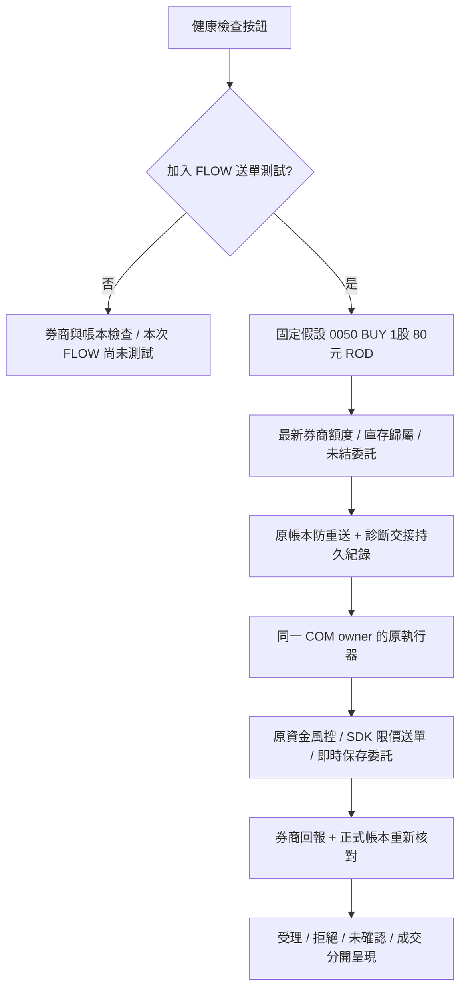

# 健康檢查的確認、固定假設送單與盤外請求

2026-11-13；基準 `dedd30b`；時間為台灣 UTC+8。依使用者要求只保留原「健康檢查」按鈕，不新增常駐按鈕或操作列。

## 操作

按健康檢查後顯示一個是／否彈窗，預設為否，完整列出可能送出的真實委託。

- **否**：繼續一般券商、帳本、資料與系統檢查，顯示「本次 FLOW／實盤送單：尚未測試」。不啟動 FLOW、不產生測試委託。
- **是**：接受 **0050、BUY、1 股、最高 80 元、ROD** 的固定診斷假設。查最新帳戶與預算，進入原執行器、原 COM owner、原正式帳本及券商核對；完成後一併顯示一般健康結果。
- 唯讀模式只做一般檢查，不開啟實盤測試選項。啟停過渡或檢查進行中，不開啟第二個測試。

此項假設不呼叫模型，不偽稱 Agent 找到投資機會。`llm_validation_scope=SCHEMA_ONLY_USER_ASSUMPTION`、`actual_model_calls=0` 與來源均明列。它驗證假設決策到交易執行的接線；真實模型研究可用性、判斷品質、選股報酬另由原 FLOW 驗證。

## 執行與保護

保留原執行器 enabled、持股 AI 停用、券商可動用金額、最低保留現金、單筆限制、未結資金與送出前停止檢查。普通策略的費後收益、配置、行情與研究規則沒有調低；診斷是使用者指定的人工固定價格委託，使用獨立至多 100 元的含緩衝現金預算，不使用 AI 配置或 AI 每日額度，沒有拿虛構目標／失效價假裝策略經濟條件已通過。

特殊限價僅由已確認的診斷入口傳入；普通 advice 即使寫入相同政策名稱也無法啟用。合約再次鎖定 0050、BUY、整數 1 股、80 元、ROD、當日固定 ID、確認資料的新鮮度與預計交易日。送單價格不改成 ask。

同日使用固定 decision ID，另在正式資料目錄以 exclusive-create + fsync 保存交接請求，並保留原 `SEND_PENDING`／`SUBMITTED` 與防重送。已交接但沒有回覆時保持未確認；反覆按是、重開 UI 或記錄寫入失敗都不能自動重送。送出前被擋、尚未交接的測試可在修正原因後重新手動確認。

## 盤外與 ROD

依使用者最新要求，盤外也可以由本人按是，嘗試交給同一券商函式收單。盤中仍要求真實非試撮零股行情；盤外使用 `USER_FIXED_LIMIT`，bid／ask／last 均為未知，時間是使用者假設授權時間，不能標成 LIVE 報價或拿來計算行情年齡／滑價。80 元是使用者最高委託價格，不保證買不到；券商可能因時段、價格範圍或其他條件拒絕。

ROD 是當日有效，盤外保留到下一交易日涉及券商預約收單能力，不由程式宣稱一定成功。交易所零股的 ROD 與交易時段規範見 [證交所交易制度](https://www.twse.com.tw/zh/products/system/trading.html?hl=zh-TW)；群益也要求自行確認正式 API 委託狀態，見 [群益 API 準備說明](https://www.capital.com.tw/apiforum/docs/preparations/)。

本地另保存 `requested_outside_session` 與 `valid_trading_date`；星期五收盤後的預計交易日是下週一。依使用者最新規則，這筆單從建立起就是人工診斷單，程式不以自己的時鐘替它標成到期，也不另加撤單／追價／每日重送排程；隔天仍掛著就保留人工標記及券商觀察記錄，不接管管理。預計交易日目前使用專案已記錄的 2026 年假日與週末；超出已驗證年份會阻擋診斷，不自行猜測跨年交易日。預計日不是券商已確認的交易日。

## 人工歸屬與額度

第一筆 `STARTED` 就原子保存 `ownership=MANUAL_DIAGNOSTIC`、`management_policy=RECORD_ONLY_NO_AI_ACTION`，包含送出前崩潰也不會失去歸屬。確認成交或隔日回補只更新這筆人工紀錄，不增加 AI 股數；AI 成本、損益、買入日期、持有計畫、轉交成本及每日交易統計均排除。券商庫存增加可依原對帳歸入人工股數，需使用者另行轉交才由 AI 管理。

AI 配置未結預留 `pending_buy_reserve_twd` 只含 AI；人工預留另為 `manual_pending_buy_reserve_twd`；帳戶總預留是 `account_pending_buy_reserve_twd`。AI 日額也排除人工診斷。人工委託可能真的消耗／圈存券商現金，這部分仍依券商及最壞情況預留，不能製造可用現金。MOCK 中人工掛單預留 100 元時，AI 上限 10,000 與 AI 日額 30,000 都不變，帳戶現金可用額另減 100。

人工回報缺價或未完整回補只記人工診斷提醒、保留帳戶現金預留，不當成 AI 成本錯誤或要求 AI 管理它；券商餘額、庫存、帳本完整性及 AI 自身不一致仍依原風控處理。

## 健康結果與須注意的處理

結果分開顯示診斷假設是否產生、是否到執行器、SDK 是否嘗試、券商是否有受理證據，以及正式帳本核對狀態。只呼叫函式或取得回傳 0 不直接算受理／成交；這筆診斷即使確認成交也屬人工。拒絕會標失敗；回覆遺失標未確認；沒有當次送單則明列尚未測試。既有診斷紀錄可在之後一般健康檢查中讀取，不因此產生新委託。

「處理方式」欄針對每項提醒提供建議：券商失敗先重查／依逾時規則重啟；未確認委託不重送；額度不足檢查交割與保留資金；資料／模型錯誤沿用補齊與退避；帳本損壞保留證據與備份，不刪除重建。普通健康檢查不替使用者啟動交易，也不降低門檻。

## 驗證

完整結果見 [regression.txt](regression.txt) 及 [verification.json](verification.json)。測試從假設 payload 經原風控、原執行器直達隔離 SDK，驗證 80 元不會變成 ask 100；也驗證拒單、成交回寫、持股停用、低餘額、過期行情、停止、防重送、盤外未知行情、預約資金保留及到期日。

使用者 17:06 曾在過渡版按是：當時 `OUTSIDE_TRADING_SESSION`，執行器未呼叫、送單 0 次。後續才依最新指示加入盤外收單嘗試；不能把先前按是當成本版已取得券商受理證據。開發驗證沒有代按實盤接受，也沒有代送新委託。

**17:45:42 使用者本人在最新確認彈窗按是後，已取得真實結果。** 17:45:58.853 進入 SDK，券商回傳 0 與委託識別，原回報核對為 `ACKNOWLEDGED`，再次對帳為 `NO_FILL_YET_VERIFIED`、完整回補，成交 0 股。委託是 0050、BUY、1 股、80 元、人工診斷，預計交易日 2026-11-16。完整診斷 38.036 秒，其中 SDK 同步呼叫 230.641 毫秒；各巢狀階段不可直接加總。

前後正式快照比對：AI 股數、AI 投入成本、AI 配置剩餘、AI 每日占用與每日剩餘皆不變；人工帳戶現金預留另列 100 元，AI 未結預留為 0。實際可動用現金須保留圈存／預留，不能與 AI 配置上限混為一談。原始委託識別保留在本機正式帳本，遠端報告只公開有識別證據，不公布識別碼或個人餘額。

依使用者確認，健康檢查將此項標 **「FLOW 送單路徑通過＊」**。星號註明這是固定假設決策經正式格式及原執行器取得真實券商收單證據；不表示模型判斷績效或未來必定成交。一般健康檢查可讀取此既有證據，不因此再次送單。人工診斷的最新執行報告另存，避免覆蓋 AI 最新執行狀態。

## 盤外行情通過＊

盤外對持股優先使用官方日線最新可取得的收盤價，明列交易日、來源、`DAILY_CLOSE_REFERENCE` 與不可即時執行。取得完整持股資料即標「持股行情通過＊」，備註只是收盤資料取得驗證；缺少個別股票則列出缺資料標的。盤內檢查當前新鮮非試撮零股報價，不能用收盤價替代。

收盤資料只投影到畫面、持股參考價／市值與估算損益，不改券商快照權威、AI 決策輸入或送單 payload。日線日期／檔案或交易時段改變時會更新快取。畫面保留收盤星號與日期，不能把前一交易日收盤說成今日即時價。

## 週一 2026-11-16 啟用

正式入口 `OpportunityFlow.cmd`／`RunOpportunityFlow.ps1 -Mode Live` 仍預設自動啟動，使用原帳戶、同一券商執行器與原正式帳本；一般 BUY／SELL 沒有新增人工確認旗標。完整 UI 留存帳戶、交割、股數歸屬及轉交操作。

接線已核對為 `ExecutionBridge → LegacyRuntime.execute → BrokerRuntime → pipeline_hook → execute_advice_file`。MOCK 同時覆蓋研究通過後 BUY、沒有新買候選的持股 SELL、買進額度 0 仍可有效 SELL、只記確認成交、防重送、停止及重啟。啟動檢查已通過，也確認 CLI 使用 ChatGPT 登入；此檢查不驗證未來配額或模型服務一定可用。

啟用時先正常關閉舊版，再開本分支正式入口，避免同帳戶兩個 Dashboard／COM owner 鎖衝突。啟動後檢查 FLOW 運行中、券商對帳新鮮及研究結果／阻擋原因有持續產生。已有有效 dataset 時，新資料暫時下載失敗仍保留持股退出維護；完全沒有有效 dataset 的冷啟動則須先補齊資料。這是可供週一正式試運轉的替代版，固定假設決策已驗證真實券商收單；模型研究、正式機會與實際成交仍須由持續運轉觀察。

最終驗證：全套 780 項通過（111.245 秒）；最後補齊官方批次資料來源名稱兼容後，9 項收盤顯示測試通過（1.045 秒）。實際持股收盤資料 5/5 取得，交易日 2026-11-12；健康 16 PASS、1 WARN、0 FAIL，唯一提醒是展示視窗 FLOW 停止。真實送單證據與收盤取得驗證皆已標為通過＊。
