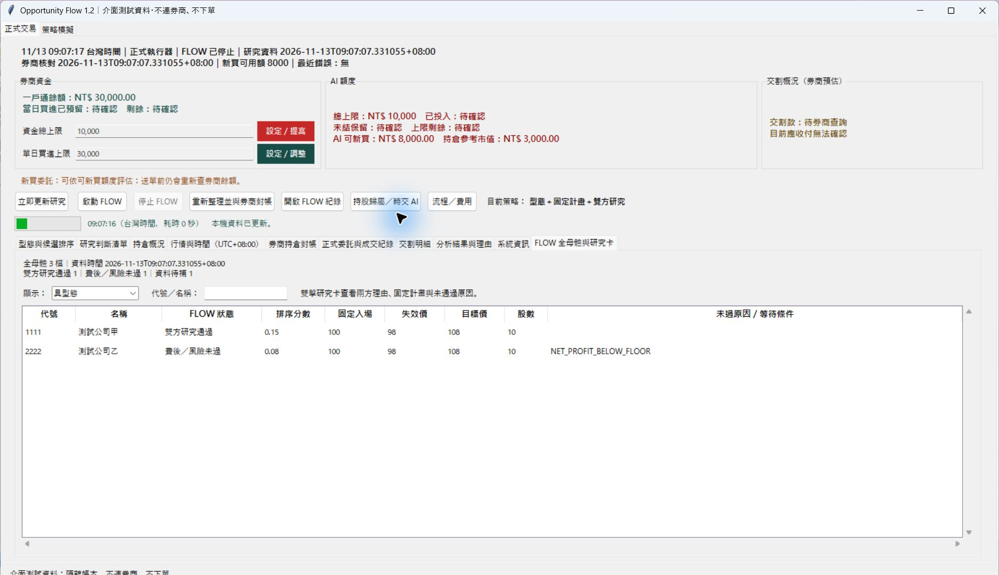

# Opportunity Flow 1.2：完整舊 UI 與最低佣金修正

2026-11-13，分支 `codex/new-system-tw-opportunity-flow`。延續 `d740a35`，研究與風控政策門檻不變。

## 介面採用方式

主入口仍為 `OpportunityFlow.cmd`／`RunOpportunityFlow.ps1 -Mode Live`，現在直接繼承原 `Dashboard`，不另複製一套金融資訊 UI。只替換掃描、模型狀態與控制的連接方式。

| 原有功能 | 1.2 處理 |
|---|---|
| 券商資金、AI 額度、交割卡片 | 沿用原顯示與原帳本；不以新研究結果代替資金或成交 |
| 資金總上限、單日買進上限 | 沿用原設定及對帳操作；只讀模式禁止修改 |
| 持倉、券商對帳、現股／可賣量、人工／AI 股數 | 沿用完整欄位與正式資料來源 |
| 人工／AI 歸屬設定 | 沿用原視窗及總 AI 股數操作；增加時記錄交接成本與原買進計畫未知，設 0 仍禁止 AI 買賣 |
| 正式委託、成交、已實現損益、完整 AI 理由 | 沿用原正式分頁；補上新 FLOW 理由的持久保存與讀取，避免只找舊分析資料夾而顯示空白 |
| 行情時間、資料年齡、交割明細、策略模擬 | 保留；公開參考價明列「非零股」，不冒充可執行價 |
| 分析／自動掃描按鈕 | 改為「立即更新研究」「啟動 FLOW」「停止 FLOW」；不啟動原小時掃描或原持倉模型排程 |
| 原 `llm/agent` 與選 MD 策略 | 新 FLOW 固定使用數值計畫與兩方研究，移除模式切換；策略按鈕改為「流程／費用」 |
| 舊量化排名與 AI 清單 | 改為型態／候選排序與研究判斷，研究通過不顯示為 BUY，不填造信心度 |
| 新流程追蹤 | 增加全母體、型態、研究、經濟條件及資料錯誤篩選、代號／名稱搜尋；雙擊研究卡查看兩方理由與固定計畫 |

最近模型錯誤、資料來源錯誤、CLI 累計用量及最新執行阻擋原因也進入畫面。若顯示資料檔損壞，保留最後完整畫面並顯示讀取錯誤，不停止 Tk 更新。

「立即更新研究」只喚醒新 watch 流程，既有研究快取、有效時段、行情時效、兩方審查及原執行器風控都仍適用。停止時等待原工作結束，不能另開第二個券商 runtime；也不會將停止等同撤掉已送委託。

## 官方費率與實際修正

[群益官方電子盤中零股說明](https://www.capital.com.tw/event/stock/oddLot/default.asp) 列出佣金率 **0.1425%、每筆最低 NT$1**。使用者已指定「沒有已知折扣，先用官方標準」，因此未套用額外折扣。

原正式設定沒有 `minimum_commission_twd`，原程式便把 `min_buy_fee_reserve_twd=20` 兼作最低佣金。資金預留與實際佣金不同，這項對電子盤中零股的假設已修正。

- 綁定正式帳戶新增明確 `minimum_commission_twd=1`、官方來源及檢查時間。
- 資金預留仍為 `min_buy_fee_reserve_twd=20`；價金緩衝、資金上限、單日上限與原其他設定全部保留。
- 配置 50%、模型損失風險 0.5%、新買進淨收益 NT$50／2%、報酬風險 1.5 均不變；原預掛開關也不變。
- 設定變更前取得原 broker-runtime OS 鎖，保留本機備份；其他帳戶若已有明確費率則不覆寫。
- 只讀模式不執行設定遷移。正式 UI／CLI 啟動時，僅對尚未明訂最低佣金的舊群益設定補入官方標準。

這次沒有券商實收手續費明細，既有損益摘要不足以反推個別折扣；因此標記為官方未折扣標準，**不宣稱個別帳戶實收已對帳**。本機完整備份及根目錄保留在忽略資料，不公開帳戶內容；遠端只保存去識別化的驗證摘要。

## 同資料重新測試

使用本機同一份官方 1,990 檔普通股、65 交易日日線，截點為 **2026-11-12 08:30 台灣時間**。兩組皆用 NT$10,000 資金、資金預留 NT$20、原獲利與風控門檻；僅改最低佣金。

| 每筆最低佣金 | 數值合格待研究 | 經濟條件未過 | 其他狀態 |
|---|---:|---:|---|
| NT$20（修正前） | 0 | 65 | 流動性未達 1,301、資料問題 177、無型態 447 |
| NT$1（官方標準） | 6 | 59 | 同上 |

這是凍結資料的數值情境；沒有套用當下券商帳戶、即時報價或新增真實模型判斷。六檔是待研究候選，並非已批准買進、可成交或策略績效。詳細分母與固定政策保存在 [fee_retest.json](fee_retest.json)。

## 驗證

全套 **691 項測試通過**，108.461 秒；其中新增 **17 項介面與費率測試**。完整輸出見 [regression.txt](regression.txt)，機器可讀證據與來源雜湊見 [acceptance.json](acceptance.json)。新增 [測試案例](../../tests/test_flow_dashboard.py) 覆蓋保留分頁、操作路由、持股交接／設零、只讀模式、啟停競爭、官方費率與資金預留分離、設定鎖、顯示資料損壞與參考價標示。

原執行器、部分成交、防重送、停止前送單檢查、退出與撤單測試繼續包含在全套回歸。測試不連實際券商、不送實盤委託；介面檢查使用明確標示的合成測試資料，不能當作使用者帳戶或成交證據。

## 畫面參考

以下畫面皆為隔離測試資料；保留舊資金與分頁配置，主頁增加全母體流程追蹤。

持股設定視窗也已目視確認沿用舊版總 AI 股數與轉入成本操作。最後一次重新擷取時，Computer Use 的 `activate_window` 連續回報 `failed to activate captured window`；未將擷取失敗當成 UI 正常證據。上圖採先前已實際觀察過的測試畫面，最新設定文字另有隔離介面測試；預設視窗高度也已依螢幕尺寸縮減。

完整資料來源與排程見 [流程參考](../../docs/OPPORTUNITY_FLOW.md)。
